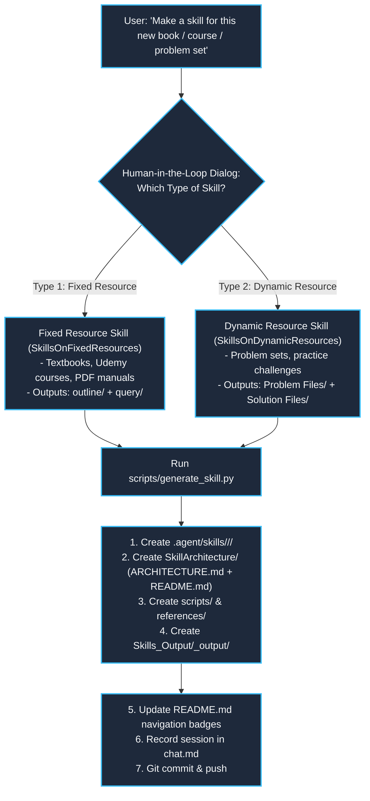

# Architecture & Operational Mechanics: `SkillGenerator`

## 1. System Overview

The **`SkillGenerator`** is a meta-skill designed to eliminate manual boilerplate creation and guarantee that every newly added skill adheres to the architecture of `Science_Of_Coding` and `Database Management System`.

---

## 2. Supported Skill Paradigms

---

## 3. Structural Matrix Comparison

| Output Folder | Type 1 (`SkillsOnFixedResources`) | Type 2 (`SkillsOnDynamicResources`) |
| :--- | :--- | :--- |
| **`.agent/skills/.../`** | `SkillsOnFixedResources/<Name>/` | `SkillsOnDynamicResources/<Name>/` |
| **`SkillArchitecture/`** | `ARCHITECTURE.md` + `<Name>_Architecture_README.md` | `ARCHITECTURE.md` + `<Name>_Architecture_README.md` |
| **References / Setup** | `table_of_contents.md` + `toc.json` | `dbms categories.docx` + `problem formatting.md` |
| **Scripts** | `query_<name>.py` (keyword / page extractor) | `ingest_manager.py` (queue reader & HITL parser) |
| **`Skills_Output/`** | `<Name>_output/outline/` & `<Name>_output/query/` | `<Name>_output/Problem Files/` & `Solution Files/` |
| **Master Index** | `<Name>_Output_README.md` | `question bank.md` & `<Name>_Output_README.md` |
