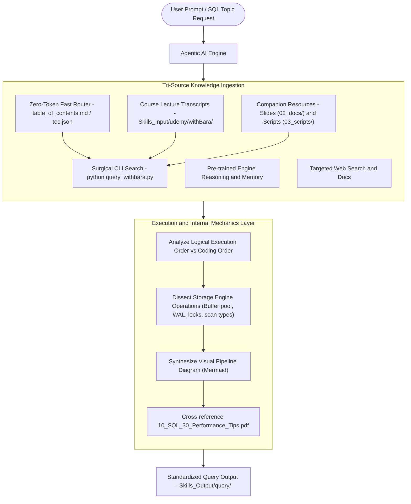

# Architecture & Operational Mechanics: `withBara` Skill

## 1. System Overview & Purpose

The **`withBara`** skill is a portable, self-contained, agent-agnostic database knowledge and retrieval module encapsulating the complete 30-hour SQL curriculum (*The Complete SQL Bootcamp*):
* **28 Core Modules & 230+ Lecture Transcripts**: Comprehensive spoken lectures explaining how SQL executes under the hood.
* **Curated Presentation Slides (`02_docs/`)**: 16 authoritative PDF slide decks and relational schemas (`SalesDB`).
* **Production SQL Reference Scripts (`03_scripts/`)**: 31 executable SQL scripts demonstrating syntax, optimizations, and data warehouse patterns.

This skill connects any agentic AI system (Antigravity, Claude Code, Cursor, Codex) to relational database engine internals without suffering from context exhaustion, token window degradation, or hallucinations.

---

## 2. Directory Layout of `withBara` Skill

```
.agent/skills/SkillsOnFixedResources/withBara/
├── SkillArchitecture/
│   ├── ARCHITECTURE.md                  <-- Detailed operational & engineering manual (this file)
│   └── withBara_Architecture_README.md  <-- High-level overview & visual workflow
├── SKILL.md                             <-- Universal agent entrypoint & query decision rules
├── references/
│   ├── table_of_contents.md             <-- Fast human & agent markdown topic index
│   └── toc.json                         <-- Machine-readable outline tree across all modules & resources
└── scripts/
    ├── index_withbara.py                <-- Automated indexing script
    ├── generate_complete_outline.py     <-- Deep curriculum & subtopic generator
    └── query_withbara.py                <-- Surgical keyword search across transcripts & SQL scripts
```

*(Note: Raw course transcripts and companion resources are stored centrally under [`Skills_Input/udemy/withBara/`](../../../../Skills_Input/udemy/withBara/))*

---

## 3. High-Level Architecture Diagram



---

## 4. Query CLI System & Zero-Token Indexing

The retrieval engine resolves the context window degradation problem through a two-phase retrieval pattern:

### Phase 1: Zero-Token Routing (Agent Memory / System Prompt)
Instead of feeding hundreds of lecture markdown files to the LLM, the agent navigates through:
- [`references/table_of_contents.md`](../references/table_of_contents.md)
- [`Skills_Output/withBara_output/outline/withBara_Complete_Course_Outline.md`](../../../../Skills_Output/withBara_output/outline/withBara_Complete_Course_Outline.md)

### Phase 2: Precision Extraction via CLI
When a topic is requested, the agent executes `query_withbara.py`:
```bash
python .agent/skills/SkillsOnFixedResources/withBara/scripts/query_withbara.py "execution order"
```
The script locates the exact `.md` transcript files, pulls targeted quotes, and matches the companion `.sql` reference scripts from `Resources/03_scripts/`.

---

## 5. Output Standardization

All generated outputs are archived under:
```
Skills_Output/withBara_output/
├── outline/                 # Exhaustive curriculum/book breakdown with all subtopics
│   └── withBara_Complete_Course_Outline.md
├── query/                   # Generated topic manuals & execution deep-dives
│   ├── 001_sql_logical_execution_order_internals.md
│   └── 002_types_of_sql_commands.md
└── withBara_Output_README.md
```

