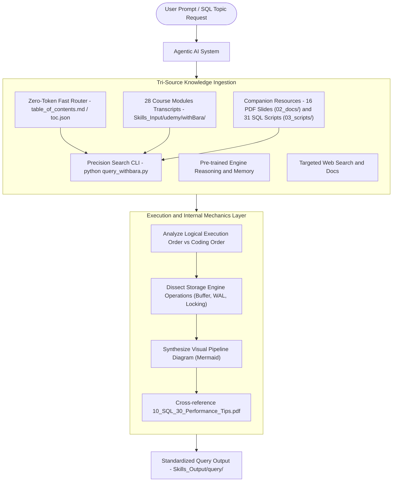

# Skill Architecture & Usage Instructions: `withBara`

This document defines the technical architecture, execution pipeline, and usage guidelines for the **`withBara`** database & SQL internals skill.

---

## 🏛️ System Architecture

The `withBara` skill connects any agentic AI system to deep SQL internals knowledge without suffering from context exhaustion, token window degradation, or hallucinations.



---

## 📖 Operational Instructions for Agents

### 1. Dual Ingestion Rule (Transcripts + Resources)
- **Rule**: Never answer from general knowledge alone. The agent **MUST** inspect the spoken `.md` lecture transcript files for the instructor's pedagogical explanation and analogies, while cross-referencing `02_docs/` for slide models and `03_scripts/` for working SQL code.

### 2. Surgical Retrieval via CLI
Instead of dumping full lecture chapters into context, use the precision CLI:
```bash
python .agent/skills/SkillsOnFixedResources/withBara/scripts/query_withbara.py "<topic>"
```

### 3. Output Standardization Protocol
Every manual generated must follow the 6-phase blueprint in [`SKILL.md`](../SKILL.md) and be saved to:
`Skills_Output/withBara_output/query/<NNN>_<topic_name>.md`
And indexed in `Skills_Output/withBara_output/withBara_Output_README.md`.

