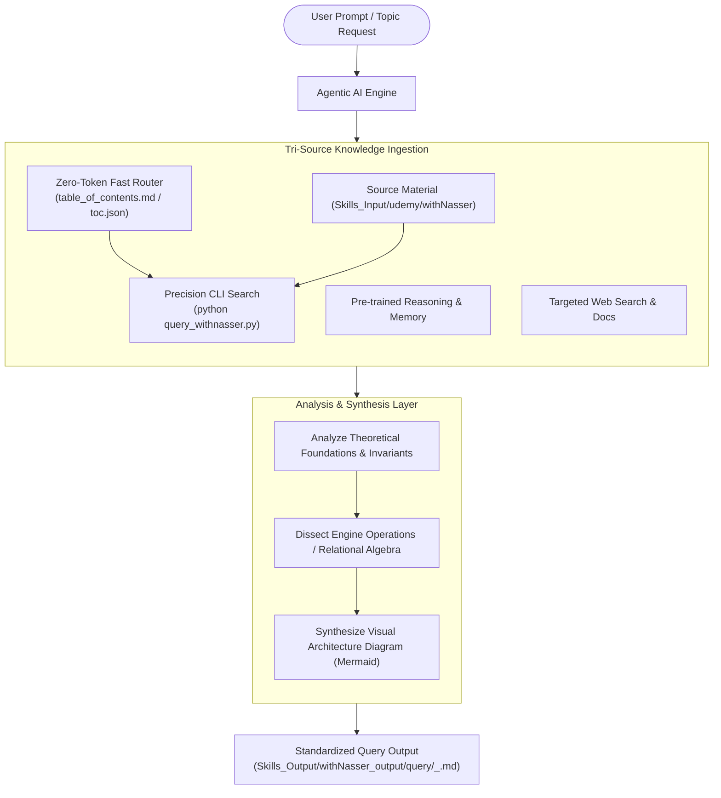

# Architecture & Operational Mechanics: `withNasser` Skill

## 1. System Overview & Purpose

The **`withNasser`** skill is a portable, self-contained, agent-agnostic knowledge and retrieval module encapsulating:
* **Resource Type**: Udemy Course (Database Engineering & Internals by Hussein Nasser)
* **Source Path**: `Skills_Input/udemy/withNasser`
* **Architecture Standard**: SkillsOnFixedResources (Type 1)

---

## 2. Directory Layout

```
.agent/skills/SkillsOnFixedResources/withNasser/
├── SkillArchitecture/
│   ├── ARCHITECTURE.md                  <-- Technical specifications (this file)
│   └── withNasser_Architecture_README.md  <-- High-level overview & agent execution rules
├── SKILL.md                             <-- Universal agent entrypoint & query decision rules
├── references/
│   ├── table_of_contents.md             <-- Fast human & agent topic index
│   └── toc.json                         <-- Machine-readable outline tree
└── scripts/
    └── query_withnasser.py        <-- Precision CLI search & extraction
```

---

## 3. High-Level Architecture Diagram


