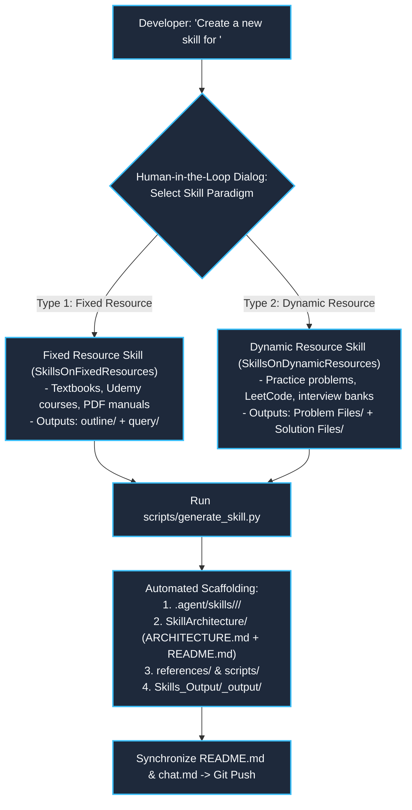
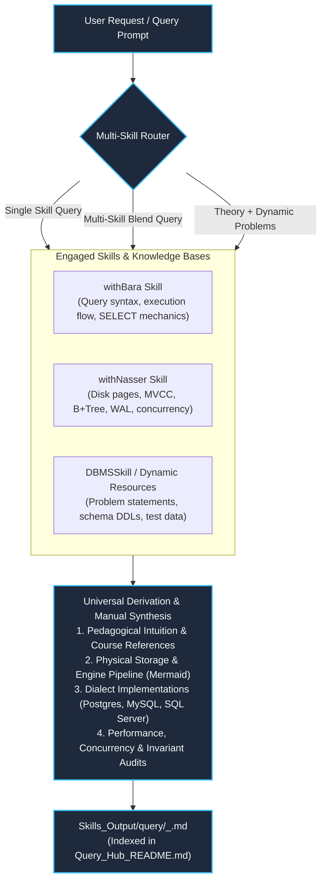

# Database Management System (DBMS)

An exhaustive, high-performance database engineering manual, storage engine architecture guide, and agentic AI skill system designed for deterministic relational modeling, query optimization, ACID concurrency analysis, and distributed database design.

---

## ⚡ Quick Navigation: Skill Outputs Hub

Access key outputs generated by each skill directly using the navigation buttons below:

### 📁 Universal Query Output Hub (Combined & Single-Skill Syntheses)
[](Skills_Output/query/Query_Hub_README.md)
[](Skills_Output/query/001_sql_logical_execution_order_internals.md)
[](Skills_Output/query/002_types_of_sql_commands.md)
[](Skills_Output/query/003_dcl_tcl_acid_properties_internals.md)

### 🛠️ `DBMSSkill` Outputs (Problem Ingestion & Dialect Solutions)
[](Skills_Output/DBMSSkill_output/Problem%20Files/question%20bank.md)
[-059669?style=for-the-badge&logo=mysql&logoColor=white)](Skills_Output/DBMSSkill_output/Solution%20Files/Solution%20formatting.md)
[](Skills_Output/DBMSSkill_output/Problem%20Files/problem%20formatting.md)

### 🎓 `withBara` Skill Outputs (SQL Mastery & Engine Execution)
[](Skills_Output/withBara_output/outline/withBara_Complete_Course_Outline.md)
[](Skills_Output/withBara_output/withBara_Output_README.md)

### 🔬 `withNasser` Skill Outputs (Database Engineering & Storage Internals)
[](Skills_Output/withNasser_output/outline/withNasser_Complete_Course_Outline.md)
[](Skills_Output/withNasser_output/withNasser_Output_README.md)

### ⚙️ System Tools & Roadmaps
[](.agent/skills/SkillGenerator/SKILL.md)
[](Upcoming%20Updates/Upcoming%20Updates.md)
[](chat.md)
[](.agent/skills/type%20of%20skills.md)

---

## 🎯 Core Philosophy & Project Objective

> *"The objective of this project is to establish deterministic control and architectural transparency over agentic database engineering models. Rather than allowing an agent to generate superficial SQL queries or unverified table schemas, the agent must anchor all designs to relational algebra, functional dependency proofs, execution plans (`EXPLAIN ANALYZE`), storage engine mechanics, and explicit human-in-the-loop consensus."*

### Moving from Black-Box AI to Collaborative Database Engineering

LLM-powered assistants frequently produce naive database code:
1. **Unchecked Schema Anti-patterns**: Proposing unnormalized designs that cause update anomalies, or prematurely denormalizing without analyzing write amplification.
2. **Missing Indexing Invariants**: Adding arbitrary indexes without calculating predicate selectivity or recognizing composite index ordering rules.
3. **Concurrency Blindness**: Writing code prone to dirty reads, non-repeatable reads, phantom rows, or deadlocks under high-concurrency transactions.

**Database Management System** solves this by establishing a **Human-in-the-Loop, Invariant-Grounded Engineering Framework**:
- **Proactive Design Consultations**: When multiple trade-offs exist (e.g., 3NF vs. BCNF, B+ Tree vs. LSM-Tree, Pessimistic Locking vs. MVCC snapshot isolation), the agent is **mandated** to present the candidate options alongside their trade-offs and seek developer confirmation before writing code.
- **Authoritative Reference Grounding**: All query optimizations and engine internals are anchored to canonical literature and verified execution metrics.

---

## 📖 Key Deliverables

1. **The DBMS Engineering Manual**: Mathematical derivations, relational algebra, SQL DDL/DML templates, and side-by-side runnable implementations in **PostgreSQL** and **MySQL**.
2. **`Skills_Input/` Directory (Central Ingestion & Reference Assets)**:
   - **`Skills_Input/books/`**: Curated textbooks and domain books (`Fundamentals/`, `Internals/`, `Distributed/`).
   - **`Skills_Input/Templates/`**: Step-by-step blueprints instructing the agent on *how* to systematically model schemas and optimize queries:
     - [`Relational Schema & Normalization Template`](Skills_Input/Templates/Relational_Schema_Normalization_Template.md): 1NF $\to$ 2NF $\to$ 3NF $\to$ BCNF minimal cover and lossless-join derivations.
     - [`Query Optimization & Indexing Template`](Skills_Input/Templates/Query_Optimization_&_Index_Template.md): Predicate selectivity, composite index rules, and `EXPLAIN ANALYZE` audits.
3. **`Skills_Output/` Directory (Output Hub & Universal Query Center)**:
   - **`Skills_Output/query/` (Unified Investigation & Multi-Skill Query Hub)**:
     - The single destination for all deep-dive manuals, internal engine breakdowns, and cross-course query solutions.
     - Supports **single-skill** lookups (e.g. `withBara`), **multi-skill combinations** (e.g. `withBara` for SQL syntax + `withNasser` for disk page & MVCC storage), and **hybrid fixed + dynamic workflows** (combining theory with real problem benchmarks).
     - Master Index: [`Skills_Output/query/Query_Hub_README.md`](Skills_Output/query/Query_Hub_README.md).
   - **`Skills_Output/DBMSSkill_output/`**:
     - `Problem Files/`: Ingestion staging area (`Source of Problem/put the file here/`), formatting specs, and the master [`question bank.md`](Skills_Output/DBMSSkill_output/Problem%20Files/question%20bank.md).
     - `Solution Files/`: Solutions organized by Primary Category and Subcategory with separate `<ID>_postgres.sql`, `<ID>_mysql.sql`, and `<ID>_derivation.md` files.
   - **`Skills_Output/<skill_name>_output/outline/`**:
     - Individual curriculum outlines for each fixed resource (e.g., [`withBara_Complete_Course_Outline.md`](Skills_Output/withBara_output/outline/withBara_Complete_Course_Outline.md), [`withNasser_Complete_Course_Outline.md`](Skills_Output/withNasser_output/outline/withNasser_Complete_Course_Outline.md)) providing zero-overhead topic discovery.
4. **`.agent/skills/` (Centralized Agent Skills Hub)**:
   - **`SkillGenerator`**: Universal meta-skill for creating production-ready agent skills via interactive Human-in-the-Loop (HITL) interviews.
   - **`SkillsOnFixedResources/`**: Reference skills (e.g., `withBara`) with zero-token Table of Contents routing, deep curriculum outlines, and surgical page extraction.
   - **`SkillsOnDynamicResources/DBMSSkill/`**: Autonomous problem ingestion, dynamic category classification (HITL), and question bank manager.
   - **`type of skills.md`**: Architectural manual documenting the fixed vs. dynamic skill paradigms.
5. **`Upcoming Updates/` Roadmap**: Milestone tracking for planned modules and upcoming manuals.
6. **`chat.md`**: Chronological log of all architectural decisions and design sessions.

---

## ⚙️ Universal Skill Generator (`SkillGenerator`)

The repository features an autonomous meta-skill, **`SkillGenerator`**, located in [`.agent/skills/SkillGenerator/`](.agent/skills/SkillGenerator/), designed to scaffold new skills conforming to the architectural standard established in `Science_Of_Coding` and `Database Management System`.

### Skill Paradigms Supported



### How to Use `SkillGenerator`

#### Option 1: Interactive Agent Prompt (HITL)
Simply prompt the agent in chat:
> *"@SkillGenerator create a new skill for the course in Skills_Input/udemy/withNasser"*

The agent will interview you on:
1. **Skill Paradigm**: Type 1 (Fixed Reference Book/Course) or Type 2 (Dynamic Intake/Problem Sets).
2. **Skill Identifier Name**: (e.g., `withNasser`, `DDIA`, `LeetCodeSQL`).
3. **Source Path**: Location of documents, textbooks, or videos in `Skills_Input/`.

The generator then scaffolds the complete folder tree, sets up `SKILL.md`, writes `SkillArchitecture/`, configures search scripts, and creates output archives automatically.

#### Option 2: Command Line Interface (CLI)
You can also generate skills directly via the terminal:

```bash
# Generate a Type 1 (Fixed Resource: Textbook or Course) Skill:
python .agent/skills/SkillGenerator/scripts/generate_skill.py \
  --type fixed \
  --name withNasser \
  --resource-type "Udemy Course" \
  --source-path "Skills_Input/udemy/withNasser" \
  --description "Database Internals & Engineering by Hussein Nasser"

# Generate a Type 2 (Dynamic Resource: Problem & Solution Bank) Skill:
python .agent/skills/SkillGenerator/scripts/generate_skill.py \
  --type dynamic \
  --name LeetCodeSQL \
  --category-doc "dbms categories.docx" \
  --description "Dynamic problem intake and multi-dialect SQL solver"
```


---

## 🗄️ Unified Query Output Architecture (`Skills_Output/query/`)

To support complex investigations where a query requires **more than one Udemy course, textbook, or a mix of theory and dynamic problem datasets**, the repository consolidates all query outputs into a single, universal directory:

```
Skills_Output/
├── query/                                 <-- UNIFIED QUERY HUB (All Single & Combined Syntheses)
│   ├── Query_Hub_README.md                <-- Master index table of all generated manuals
│   ├── 001_sql_logical_execution_order_internals.md
│   ├── 002_types_of_sql_commands.md
│   ├── 003_dcl_tcl_acid_properties_internals.md
│   └── 004_acid_transactions_concurrency_deep_dive.md
├── withBara_output/
│   ├── outline/                           <-- Curriculum breakdown for withBara
│   └── withBara_Output_README.md
├── withNasser_output/
│   ├── outline/                           <-- Curriculum breakdown for withNasser
│   └── withNasser_Output_README.md
└── DBMSSkill_output/
    ├── Problem Files/                     <-- Problem ingestion & Question Bank
    └── Solution Files/                    <-- Categorized dialect implementations
```

### Multi-Skill Synthesis Workflow



### Why a Single `query/` Folder?
1. **Eliminates Source Siloing**: A query like *"How does an index seek behave during an MVCC transaction isolation scan?"* spans both `withBara` (indexing syntax and query execution) and `withNasser` (MVCC snapshots, tuple visibility, and slotted page storage). Storing it in an arbitrary course folder fragments documentation.
2. **Deterministic Numbering (`001`, `002`, `003`...)**: All manuals form a continuous, cumulative engineering manual.
3. **Multi-Dialect Grounding**: Seamlessly incorporates dynamic real-world problems and schema benchmarks alongside textbook theory.
