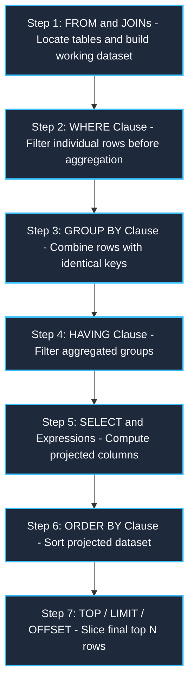

# 001: SQL Logical Execution Order & Internal Engine Processing

A comprehensive, internal engine manual based on **Section 02: SELECT Query (Lecture 10: Coding & Execution Order)** from the *withBara* SQL course, cross-referenced with companion materials in `Resources/02_docs/02_Query_Data_SELECT.pdf` and `Resources/03_scripts/01_Query_Data_SELECT.sql`.

---

## 1. Course Context & Educational Focus
- **Course Module**: `02_SELECT Query`
- **Key Lectures**:
  - `03_SELECT & FROM.md`
  - `04_WHERE.md`
  - `06_GROUP BY.md`
  - `07_HAVING.md`
  - `10_Coding & Execution Order.md`
- **Companion Resources**:
  - Slides: `Skills_Input/udemy/withBara/Resources/02_docs/02_Query_Data_SELECT.pdf` (Pages on Execution Order)
  - Reference Script: `Skills_Input/udemy/withBara/Resources/03_scripts/01_Query_Data_SELECT.sql` (Section 10: "ALL TOGETHER")
  - Database Model: `SalesDB` (`customers`, `orders`)

---

## 2. Intuition: Why Coding Order ≠ Execution Order

In SQL, we write queries declaratively (describing *what* we want to see), but the relational database engine executes them procedurally (determining *how* to find and filter data efficiently).

As emphasized in the course:
> *"If you sit back and look at a SQL query, what you write first is `SELECT`. But the database engine actually executes `SELECT` almost at the very end (at Step 5)! Once you understand the physical and logical order of how SQL executes your query, you stop making syntax errors and begin to understand how to write high-performance SQL."*

### The 5 Different Types of Filtering in SQL
The course highlights that almost every clause in a SELECT query is actually a specialized filter:
1. **Column Filter**: `SELECT` (filters *which attributes/columns* are projected into the result).
2. **Duplicate Filter**: `DISTINCT` (filters out identical repeated rows).
3. **Row-Count Filter**: `TOP` / `LIMIT` (filters based strictly on row position/count without conditions).
4. **Pre-Aggregation Row Filter**: `WHERE` (filters individual raw rows *before* grouping occurs).
5. **Post-Aggregation Row Filter**: `HAVING` (filters aggregated groups *after* grouping occurs).

---

## 3. Physical & Logical Execution Pipeline

Below is the step-by-step internal pipeline executed by the SQL engine:



### Detailed Engine Breakdown

#### Step 1: `FROM` (+ `JOIN`)
- **What the Engine Does**: The engine identifies the target table(s) from disk or the buffer pool. If multiple tables are joined, it constructs a Cartesian product or executes hash/nested-loop joins to create the base working dataset.
- **Engine Rule**: All subsequent operations operate *only* on the rows identified here.

#### Step 2: `WHERE`
- **What the Engine Does**: Evaluates boolean predicate conditions against every row in the base dataset. Rows that evaluate to `FALSE` or `UNKNOWN` (NULL) are immediately dropped.
- **Why You Cannot Use Aggregates Here**: `COUNT()`, `SUM()`, and `AVG()` do not exist yet because grouping has not occurred!

#### Step 3: `GROUP BY`
- **What the Engine Does**: The remaining rows are partitioned into buckets based on matching values in the `GROUP BY` column(s). Aggregate functions are calculated per bucket.

#### Step 4: `HAVING`
- **What the Engine Does**: Evaluates predicate filters on the calculated aggregated buckets. Buckets failing the condition are discarded.

#### Step 5: `SELECT` & `DISTINCT`
- **What the Engine Does**: The engine finally processes the column list. Expressions and aliases (`AS total_revenue`) are computed here. If `DISTINCT` is specified, a hash table or sort-unique operation runs to eliminate duplicates.
- **Key Insight**: Column aliases created in `SELECT` cannot be referenced in `WHERE` or `GROUP BY` because Step 5 happens *after* Steps 2 and 3!

#### Step 6: `ORDER BY`
- **What the Engine Does**: Sorts the final projected rows based on specified sorting criteria. Because this runs after Step 5, it **can** reference column aliases created in `SELECT`.

#### Step 7: `TOP` / `LIMIT`
- **What the Engine Does**: Slices the top `N` rows from the sorted dataset and discards the rest.

---

## 4. Coding Order vs. Execution Order Comparison

| Order | What You Write (Syntax Order) | What SQL Engine Runs (Execution Order) | Reason for Order |
| :---: | :--- | :--- | :--- |
| **1** | `SELECT` | `FROM` / `JOIN` | Must locate the data first before operating on it. |
| **2** | `DISTINCT` | `WHERE` | Scope down data as early as possible to save RAM. |
| **3** | `TOP` / `LIMIT` | `GROUP BY` | Aggregate data into buckets. |
| **4** | `Column List / Expressions` | `HAVING` | Filter aggregated buckets. |
| **5** | `FROM` | `SELECT` / `DISTINCT` | Evaluate expressions and format columns. |
| **6** | `WHERE` | `ORDER BY` | Sorting is expensive; sort only the final output. |
| **7** | `GROUP BY` | `TOP` / `LIMIT` | Final row slicing. |
| **8** | `HAVING` | — | — |
| **9** | `ORDER BY` | — | — |

---

## 5. Practical Query Walkthrough (from `01_Query_Data_SELECT.sql`)

Consider this complete master query from the course scripts:

```sql
SELECT TOP 2
    country,
    COUNT(customer_id) AS total_customers,
    SUM(score) AS total_score
FROM customers
WHERE score > 100
GROUP BY country
HAVING COUNT(customer_id) > 1
ORDER BY total_score DESC;
```

### Step-by-Step Engine Execution for this Query:
1. `FROM customers`: Engine loads customer records.
2. `WHERE score > 100`: Filters out low-score customers immediately.
3. `GROUP BY country`: Buckets the remaining high-score customers by country (`USA`, `Germany`, etc.).
4. `HAVING COUNT(customer_id) > 1`: Drops countries that only have 1 qualifying customer.
5. `SELECT ... AS total_score`: Computes projected values and assigns the alias `total_score`.
6. `ORDER BY total_score DESC`: Sorts the qualifying countries from highest to lowest score.
7. `TOP 2`: Returns only the top 2 countries and terminates.

---

## 6. Universal Rule 9: 3-Tier Concept Mapping (Java -> SQL Wire -> Physical Table)

To understand how logical execution order actually executes from backend application code down to physical memory pages, we trace this query across all three physical tiers:

### Layer 1: Coding Level (Strictly Java Only)
```java
package com.dbms.query;

import java.sql.Connection;
import java.sql.DriverManager;
import java.sql.PreparedStatement;
import java.sql.ResultSet;
import java.sql.SQLException;
import java.util.ArrayList;
import java.util.List;

public class CustomerMetricsService {
    private static final String JDBC_URL = "jdbc:postgresql://localhost:5432/salesdb";
    private static final String USER = "app_user";
    private static final String PASS = "app_password";

    public record CountrySummary(String country, long totalCustomers, double totalScore) {}

    public List<CountrySummary> getTopScoringCountries(int minScore, int minCustomerCount, int limit) {
        // Query written declaratively: SELECT first, FROM second
        String sql = """
            SELECT country,
                   COUNT(customer_id) AS total_customers,
                   SUM(score) AS total_score
            FROM customers
            WHERE score > ?
            GROUP BY country
            HAVING COUNT(customer_id) > ?
            ORDER BY total_score DESC
            LIMIT ?
            """;

        List<CountrySummary> summaries = new ArrayList<>();

        try (Connection conn = DriverManager.getConnection(JDBC_URL, USER, PASS);
             PreparedStatement pstmt = conn.prepareStatement(sql)) {

            // Bind runtime query parameters safely (avoids SQL injection)
            pstmt.setInt(1, minScore);             // Step 2 filter: score > 100
            pstmt.setInt(2, minCustomerCount);    // Step 4 filter: count > 1
            pstmt.setInt(3, limit);                // Step 7 slicing: top 2

            try (ResultSet rs = pstmt.executeQuery()) {
                // Read streaming cursor buffer received from database engine
                while (rs.next()) {
                    summaries.add(new CountrySummary(
                        rs.getString("country"),
                        rs.getLong("total_customers"),
                        rs.getDouble("total_score")
                    ));
                }
            }
        } catch (SQLException e) {
            System.err.println("[QUERY ERROR] " + e.getSQLState() + " : " + e.getMessage());
        }

        return summaries;
    }
}
```

### Layer 2: Database Query & Engine Logical Execution Plan
```sql
-- Emitted Query across the wire protocol:
SELECT country, COUNT(customer_id) AS total_customers, SUM(score) AS total_score
FROM customers
WHERE score > 100
GROUP BY country
HAVING COUNT(customer_id) > 1
ORDER BY total_score DESC
LIMIT 2;
```

#### Internal Engine Pipeline Progression:
1. **Stage 1 (`FROM customers`)**: The storage engine loads Table Descriptor metadata, opens data files on disk, and scans physical 8KB data pages into the RAM Buffer Pool.
2. **Stage 2 (`WHERE score > 100`)**: Row-level Predicate Pushdown evaluates boolean condition against each loaded tuple in memory before grouping. Unqualified tuples are discarded immediately, saving RAM aggregation memory.
3. **Stage 3 (`GROUP BY country`)**: Hash Aggregate operator builds an in-memory Hash Table keyed by `country`. It accumulates `COUNT(customer_id)` and `SUM(score)` for matching buckets.
4. **Stage 4 (`HAVING COUNT(customer_id) > 1`)**: Scans hash table buckets and evicts any country bucket whose customer count is 1 or less.
5. **Stage 5 (`SELECT country, total_score`)**: Computes projected mathematical expressions and exposes column aliases.
6. **Stage 6 (`ORDER BY total_score DESC`)**: Runs quicksort or external merge sort on the remaining Hash Aggregate output rows.
7. **Stage 7 (`LIMIT 2`)**: Limits output cursor stream to 2 rows and returns tabular result set to Java JDBC client.

---

### Layer 3: Physical Table & Intermediate Memory Transformations

#### Step 1: Base Physical Table on Disk (`FROM customers`)

| customer_id | first_name | country | score | Page ID |
| :--- | :--- | :--- | :--- | :--- |
| `1` | Alice | `USA` | `250` | Page #1 |
| `2` | Bob | `Germany` | `80` | Page #1 |
| `3` | Charlie | `USA` | `300` | Page #1 |
| `4` | David | `Germany` | `150` | Page #2 |
| `5` | Emma | `UK` | `120` | Page #2 |
| `6` | Frank | `Germany` | `200` | Page #2 |

#### Step 2: Intermediate Memory After `WHERE score > 100` (Pre-Aggregation Filter)
*(Bob with score 80 is discarded before any group hash table is created)*

| customer_id | country | score | Status in RAM Buffer |
| :--- | :--- | :--- | :--- |
| `1` | `USA` | `250` | Retained |
| `3` | `USA` | `300` | Retained |
| `4` | `Germany` | `150` | Retained |
| `5` | `UK` | `120` | Retained |
| `6` | `Germany` | `200` | Retained |

#### Step 3: Hash Aggregate Table After `GROUP BY country`

| Hash Key (`country`) | `COUNT(customer_id)` | `SUM(score)` |
| :--- | :--- | :--- |
| `USA` | `2` | `550` |
| `Germany` | `2` | `350` |
| `UK` | `1` | `120` |

#### Step 4: Buckets After `HAVING COUNT(customer_id) > 1` (Post-Aggregation Filter)
*(UK bucket with count = 1 fails predicate and is evicted)*

| Hash Key (`country`) | `COUNT(customer_id)` | `SUM(score)` |
| :--- | :--- | :--- |
| `USA` | `2` | `550` |
| `Germany` | `2` | `350` |

#### Step 5, 6 & 7: Final Result Stream Sent to Java Client (`SELECT` + `ORDER BY` + `LIMIT 2`)

| country | total_customers | total_score |
| :--- | :--- | :--- |
| `USA` | `2` | `550` |
| `Germany` | `2` | `350` |

---

## 7. Performance Tips & Traps (Course References)

Based on `10_SQL_30_Performance_Tips.pdf`:
1. **Filter Early with `WHERE`, Not `HAVING`**:
   - ❌ *Anti-Pattern*: Grouping 1,000,000 rows and filtering out inactive users in `HAVING`.
   - ✅ *Optimized*: Filter inactive users in `WHERE` (Step 2) before the engine wastes memory aggregating (Step 3).
2. **Alias Visibility Rule**:
   - `SELECT score * 1.1 AS adjusted_score FROM customers WHERE adjusted_score > 500;` → **Fails with syntax error** because `WHERE` runs at Step 2, long before `adjusted_score` is defined in Step 5.

