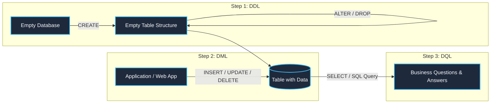

# 002: Types of SQL Commands & Engine Operational Families

A comprehensive, internal engine manual based on **Section 01: Introduction to SQL (Lecture 08: Types of SQL Commands)** from the *withBara* SQL course, cross-referenced with companion materials in `Resources/02_docs/01_SQL_Introduction.pdf` and `Resources/03_scripts/SQL_Cheat_Sheet.sql`.

---

## 1. Course Context & Educational Focus
- **Course Module**: `01_Introduction to SQL`
- **Lecture**: `08_Types of SQL Commands.md`
- **Companion Resources**:
  - Slide Deck: `Skills_Input/udemy/withBara/Resources/02_docs/01_SQL_Introduction.pdf`
  - Reference Script: `Skills_Input/udemy/withBara/Resources/03_scripts/SQL_Cheat_Sheet.sql`

---

## 2. Intuition & The Story of a Database

As taught in the course, rather than memorizing dry acronyms, you understand the types of SQL commands by walking through **the lifecycle of an empty database**:

1. **Step 1: You have an empty database.** There are no tables, columns, or constraints. You must *define* the structure.
2. **Step 2: You now have empty tables.** You need an application or user to *manipulate* and load data into those structures.
3. **Step 3: You have tables filled with data.** Now business users and analysts can ask analytical questions and *query* the data.

---

## 3. The Three Primary SQL Families

### 1. DDL: Data Definition Language (Building the Skeleton)
- **Purpose**: Defines, modifies, or deletes the metadata and structural objects (tables, schemas, views, indexes) in the database.
- **Engine Impact**: DDL commands write to the database catalog / data dictionary. They alter schema definitions, allocate storage extents, and manage structural constraints.
- **Key Commands**:
  - `CREATE`: Builds brand-new objects (e.g., `CREATE TABLE customers (...)`).
  - `ALTER`: Modifies an already existing structure (e.g., adding a column, modifying data types: `ALTER TABLE customers ADD email VARCHAR(100)`).
  - `DROP`: Permanently removes an object and all its stored data (e.g., `DROP TABLE customers`).
  - `TRUNCATE`: Quickly empties a table by deallocating its storage pages rather than logging row-by-row deletes.

### 2. DML: Data Manipulation Language (Managing the Data Inside)
- **Purpose**: Populates, modifies, and deletes the actual row records stored inside existing tables.
- **Engine Impact**: DML commands interact with the storage engine's buffer cache and Write-Ahead Log (WAL / Transaction Log). They generate transaction records, acquire row/page locks, and maintain index entries.
- **Key Commands**:
  - `INSERT`: Adds brand new rows into a table (e.g., `INSERT INTO customers (id, name) VALUES (1, 'Basel')`).
  - `UPDATE`: Modifies values in existing rows based on conditions (e.g., `UPDATE customers SET score = 100 WHERE id = 1`).
  - `DELETE`: Removes specific rows based on predicates (e.g., `DELETE FROM customers WHERE id = 1`).

### 3. DQL: Data Query Language (Asking Analytical Questions)
- **Purpose**: Retrieves and analyzes data stored in the database without modifying the underlying tables or structures.
- **Engine Impact**: Triggers the Query Optimizer, executes logical query processing (`FROM` $\to$ `WHERE` $\to$ `GROUP BY` $\to$ `HAVING` $\to$ `SELECT` $\to$ `ORDER BY`), reads data from the buffer cache, and streams results back to the client.
- **Key Command**:
  - `SELECT`: The single, most widely used command in SQL. It forms the backbone of queries, reports, dashboards, and analytical pipelines.

---

## 4. Extended Categories (DCL & TCL)

In enterprise relational databases (and in Sections 03 & 20 of the course), two additional operational families complete the SQL engine suite:

| Category | Full Name | Core Commands | Engine Role |
| :--- | :--- | :--- | :--- |
| **DCL** | Data Control Language | `GRANT`, `REVOKE` | Controls security, user permissions, and access privileges to database objects. |
| **TCL** | Transaction Control Language | `COMMIT`, `ROLLBACK`, `SAVEPOINT` | Manages atomicity and durability of DML operations within transactions. Ensures ACID compliance. |

---

## 5. Comprehensive Summary Comparison Table

| Category | What It Operates On | Primary Keywords | Transaction Log Impact | Real-World Metaphor |
| :--- | :--- | :--- | :--- | :--- |
| **DDL** | **Structure** (Tables, Schemas, Indexes) | `CREATE`, `ALTER`, `DROP`, `TRUNCATE` | Minimal / Metadata updates | Constructing the rooms of a warehouse |
| **DML** | **Data Rows** (Contents inside tables) | `INSERT`, `UPDATE`, `DELETE`, `MERGE` | Heavy (row-level logging & locking) | Stocking and moving boxes inside the warehouse |
| **DQL** | **Retrieval** (Read-only analytical output) | `SELECT` | Zero (Read-only; shared locks/snapshots) | Inspecting and counting the inventory |
| **TCL** | **Transactions** (Unit of work) | `COMMIT`, `ROLLBACK`, `SAVEPOINT` | Flushes transaction logs to disk | Signing off on shipment confirmations |
| **DCL** | **Permissions** (Security) | `GRANT`, `REVOKE` | Security catalog updates | Issuing security badges to warehouse workers |

