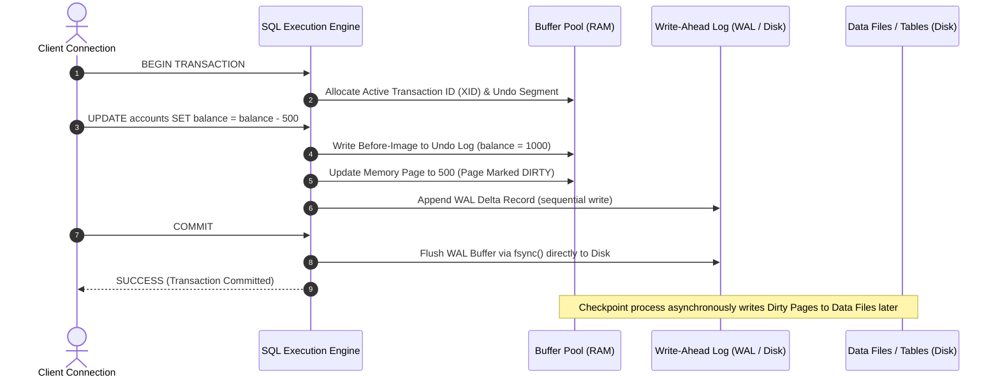
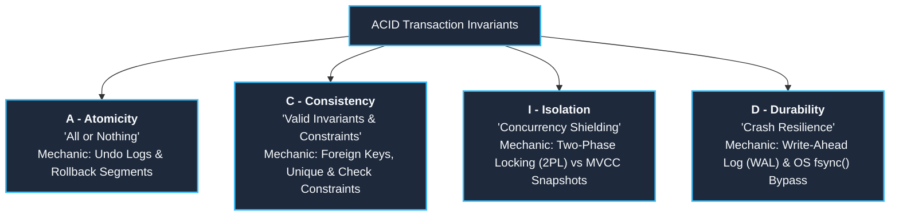

# 003: DCL, TCL & ACID Transaction Engine Architecture

A unified, deep-dive database engineering manual synthesized by blending **`withBara` (Query structure, DCL/TCL syntax, operational lifecycle)** and **`withNasser` (Storage engine internals, WAL fsync mechanics, OS buffer cache bypass, Undo stacks, MVCC, and Concurrency Read Phenomena)**.

---

## 1. Context & Multi-Source Synthesis

| Perspective | `withBara` Contribution | `withNasser` Contribution |
| :--- | :--- | :--- |
| **SQL Operational Lifecycle** | Database lifecycle: Schema structure (`DDL`) $\to$ Data population (`DML`) $\to$ Analytical questions (`DQL`). | How client TCP connections and multi-worker threads introduce concurrency conflicts on disk pages. |
| **DCL / Governance** | Syntax and permission hierarchy: `GRANT`, `REVOKE`, `DENY`. | Authorization tokens evaluated against system catalog pages before physical query execution. |
| **TCL / Transactions** | Logical units of work: `BEGIN`, `COMMIT`, `ROLLBACK`, `SAVEPOINT`. Banking transfer model. | Active transaction IDs (XID), Undo Log stacks, Rollback segments, and memory page dirty bits. |
| **Durability Mechanics** | High-level transaction persistence to disk. | **OS Buffer Cache bypass**, the critical role of `fsync()`, and why writing random B-tree pages is slow vs sequential Write-Ahead Logging (WAL). |
| **Isolation Mechanics** | Basic multi-user concurrency and locking concepts. | **Read Phenomena** (Dirty Reads, Non-Repeatable Reads, Phantom Reads, Lost Updates), **Pessimistic (2PL)** vs **Optimistic (MVCC)**, and how PostgreSQL (row versioning) differs from MySQL/InnoDB (Undo logs). |

---

## 2. DCL: Data Control Language (Security & Privilege Governance)

### What is DCL?
DCL commands manage user privileges, role-based access control (RBAC), and security permissions across tables, schemas, views, and stored procedures.


### Core DCL Commands
- **`GRANT`**: Allocates specific permissions (`SELECT`, `INSERT`, `UPDATE`, `DELETE`, `EXECUTE`) to a user, group, or role.
  ```sql
  GRANT SELECT, INSERT ON customers TO SalesAppRole;
  GRANT EXECUTE ON PROCEDURE ProcessMonthlyInvoice TO FinanceTeam;
  ```
- **`REVOKE`**: Removes previously granted permissions.
  ```sql
  REVOKE DROP, TRUNCATE ON customers FROM SalesAppRole;
  ```
- **`DENY`** *(SQL Server / Enterprise Dialects)*: Explicitly blocks a user or role from executing an action, overriding any inherited permissions.

### Engine Internals: System Catalog Lookups
When a client sends a SQL query, the database engine executes an **Authorization Phase** before query compilation. It validates the session's security credentials against the cached system catalog (e.g., `sys.database_permissions` in SQL Server, `pg_authid` in PostgreSQL, `mysql.user` in MySQL). If authorization fails, the query is rejected with zero disk read overhead.

---

## 3. TCL: Transaction Control Language (Controlling Units of Work)

### What is a Transaction?
A transaction is a logical boundary wrapping one or more SQL statements (usually DML: `INSERT`, `UPDATE`, `DELETE`) that must execute together as a single, indivisible unit of work.

### The Banking Metaphor (Why TCL is Mandatory)
Consider transferring \$500 between two bank accounts:
```sql
BEGIN TRANSACTION;
-- Step 1: Deduct from Account A
UPDATE accounts SET balance = balance - 500 WHERE account_id = 'A';

-- CRITICAL WINDOW: Power failure, network disconnection, or process termination --

-- Step 2: Add to Account B
UPDATE accounts SET balance = balance + 500 WHERE account_id = 'B';
COMMIT;
```
If the system crashes after Step 1, \$500 vanishes without TCL. With TCL, the engine guarantees that both updates either **commit together** or **roll back completely**.

---

### Core TCL Commands & Mechanics



1. **`BEGIN TRANSACTION`** (or `START TRANSACTION`):
   - Opens a transactional boundary.
   - The engine assigns a unique **Transaction ID (XID)** in the active transaction table.
2. **`COMMIT`**:
   - Persists all operations permanently.
   - **Engine Action**: The engine appends a commit record to the **Write-Ahead Log (WAL / Redo Log)** and issues an `fsync()` system call to flush the log buffer to physical non-volatile storage. Once this log write completes, the client receives confirmation.
3. **`ROLLBACK`**:
   - Reverts all uncommitted changes back to the state before `BEGIN`.
   - **Engine Action**: The engine walks backward through the **Undo Log**, restoring previous column values into the memory buffer, and releases acquired row locks.
4. **`SAVEPOINT <name>`**:
   - Sets an intermediate checkpoint inside a large transaction, allowing partial rollbacks without aborting the entire sequence.
   ```sql
   BEGIN TRANSACTION;
   INSERT INTO orders (order_id, customer_id) VALUES (101, 1);
   SAVEPOINT Step1Completed;

   -- Risky operation
   UPDATE inventory SET stock = stock - 1 WHERE product_id = 999;
   
   -- If an error occurs, rollback only to Step1:
   ROLLBACK TRANSACTION Step1Completed;
   COMMIT;
   ```

---

## 4. The ACID Properties: Deep Engine Internals & Concurrency Invariants

Relational databases guarantee reliability through four invariant properties: **Atomicity**, **Consistency**, **Isolation**, and **Durability**.



---

### 1. Atomicity ("All or Nothing")

- **The Problem**: A transaction executes 5 updates; after update 3, an unhandled exception or power crash kills the process.
- **Engine Mechanics (Hussein Nasser Deep Dive)**:
  - Database systems implement **Undo Logs** (Rollback Segments in Oracle, Undo Pages in MySQL InnoDB, WAL deltas in PostgreSQL).
  - Every modified row stores its *old value* (the before-image) in the undo structure.
  - If a transaction aborts or fails, the engine executes an **Undo Pass**, reading the undo chain in reverse order to overwrite dirty RAM buffers with original values.

---

### 2. Consistency ("Preserving Invariants")

- **The Problem**: Business rules violated during execution (e.g. negative balances, dangling foreign keys, orphan records).
- **Engine Mechanics**:
  - Consistency in ACID represents *state invariants*. The database must transition only from one valid state to another valid state.
  - Enforced through:
    1. **Primary & Unique Key Constraints**: Prevents duplicate records using index checks.
    2. **Foreign Key Integrity**: Enforces parent-child relationships (`ON DELETE CASCADE / RESTRICT`).
    3. **Check Constraints**: Enforces domain bounds (`CHECK (balance >= 0)`).
  - If any constraint evaluates to `FALSE` during transaction execution, the engine automatically aborts the statement and triggers an internal rollback.

---

### 3. Isolation ("Shielding Concurrent Workers")

As Hussein Nasser emphasizes, isolation is **the most complex, underrated property in database engineering**. When hundreds of TCP connections execute transactions concurrently, four nasty **Read Phenomena** arise:

#### The 4 Read Phenomena:
1. **Dirty Read**: Transaction A reads data modified by Transaction B that has *not yet committed*. If Transaction B rolls back, Transaction A operated on invalid data.
2. **Non-Repeatable Read**: Transaction A reads a row value. Transaction B updates that row and commits. Transaction A re-reads the row and gets different data.
3. **Phantom Read**: Transaction A executes a range query (`WHERE score > 80`). Transaction B inserts a new row matching that range and commits. Transaction A re-runs the query and discovers a new "phantom" row that did not exist before.
4. **Lost Update**: Transaction A and Transaction B read the same row concurrently, calculate updates, and write back. The faster transaction's update is completely overwritten by the slower one.

```mermaid
flowchart LR
    subgraph DirtyRead["Dirty Read"]
        T1a[T1: Read Row 1] --> T2a[T2: Update Row 1] --> T1b[T1: Re-read Row 1] --> T2b[T2: ROLLBACK]
    end

    subgraph NonRepeatableRead["Non-Repeatable Read"]
        T3a[T1: Read Row 1 (Val: 10)] --> T4a[T2: Update Row 1 (Val: 15) & COMMIT] --> T3b[T1: Re-read Row 1 (Val: 15)]
    end

    subgraph PhantomRead["Phantom Read"]
        T5a[T1: Range Query (Found 2 rows)] --> T6a[T2: INSERT Row 3 & COMMIT] --> T5b[T1: Re-run Range Query (Found 3 rows)]
    end
```

#### The Four SQL Isolation Levels:
| Isolation Level | Dirty Read | Non-Repeatable Read | Phantom Read | Engine Mechanism |
| :--- | :---: | :---: | :---: | :--- |
| **Read Uncommitted** | ❌ Allowed | ❌ Allowed | ❌ Allowed | Direct reads from dirty memory buffers; zero locking. |
| **Read Committed** *(Postgres Default)* |  Prevented | ❌ Allowed | ❌ Allowed | Every individual query takes a new MVCC snapshot. |
| **Repeatable Read** *(MySQL Default)* |  Prevented |  Prevented | ❌ /  Prevented* | Snapshot established once at transaction start; row locks or version pointers held. |
| **Serializable** |  Prevented |  Prevented |  Prevented | Strict 2PL range locks, predicate locks, or Serializable Snapshot Isolation (SSI). |

*\*Note: In MySQL InnoDB, Repeatable Read also prevents Phantom Reads in practice using **Next-Key Locks** (combining index record locks with gap locks).*

#### Engine Concurrency Architectures:
- **Pessimistic Concurrency (Two-Phase Locking - 2PL)**:
  - Uses Shared Locks (`S-Lock`) for reading and Exclusive Locks (`X-Lock`) for writing.
  - Readers block writers; writers block readers. High safety, but causes lock escalation, contention, and deadlocks.
- **Optimistic Concurrency / MVCC (Multi-Version Concurrency Control)**:
  - **PostgreSQL**: When a row is updated, PostgreSQL does not overwrite the row in place. It appends a **new version (tuple)** to the data page tagged with `xmin` (creating transaction) and `xmax` (deleting transaction). Readers never block writers!
  - **MySQL / InnoDB**: Modifies the row in place on the data page, but builds an **Undo Log chain** in memory/disk. When a reader requires an older snapshot, it traverses the undo log backward to reconstruct the earlier state.

---

### 4. Durability ("Surviving Crashes & The OS Cache Problem")

Durability guarantees that once a transaction commits, its modifications will **never be lost**, even if the machine loses power a millisecond later.

#### The OS Cache Trap & The `fsync()` Solution
As detailed in Hussein Nasser's lecture:
> *"When a database issues a write command, the operating system (Windows/Linux) does something shady: it doesn't write to disk immediately. It writes to the **OS Page Cache** in RAM to batch writes for performance. If the server loses power while the log is still in the OS cache, the database lied to you about committing!"*

```mermaid
flowchart TD
    AppCommit[Client issues COMMIT] --> DBEngine[Database Engine]
    DBEngine -->|Write WAL Record| LogBuffer[Database Log Buffer in RAM]
    
    subgraph DangerousPath["The OS Cache Trap (Default OS Behavior)"]
        LogBuffer -->|Standard OS write| OSCache[OS Page Cache (Volatile RAM)]
        OSCache -.->|Power Loss!| DataLost[DATA LOST! Database Lied]
    end

    subgraph DurablePath["The ACID Durability Path"]
        LogBuffer -->|fsync / Flush System Call| DiskController[Storage Disk Controller]
        DiskController -->|Persisted| PhysicalDisk[(Non-Volatile SSD / NVMe / HDD)]
    end
    
    PhysicalDisk --> ACK[Return COMMIT Success to Client]

    classDef safe fill:#065f46,stroke:#10b981,stroke-width:2px,color:#f8fafc;
    classDef danger fill:#7f1d1d,stroke:#ef4444,stroke-width:2px,color:#f8fafc;
    class DurablePath,PhysicalDisk,ACK safe;
    class DangerousPath,DataLost danger;
```

#### Why Write-Ahead Logging (WAL) Instead of Writing Tables Directly?
- Writing modified table pages directly to disk is **extremely slow** because data pages are scattered across disk (Random I/O), and tables have indexes, secondary B-trees, and constraints.
- Instead, the engine writes only a compact delta record to the **WAL** (Sequential I/O), which is orders of magnitude faster.
- The engine issues `fsync()` to force the OS to bypass its cache and write the WAL record to disk. Only after the WAL write succeeds does the engine return `COMMIT OK`.

#### The ARIES Crash Recovery Algorithm:
On reboot after an abrupt crash, the database engine recovers in 3 phases:
1. **Analysis Phase**: Scans the WAL forward from the last checkpoint to identify active transactions and dirty buffer pages at the time of the crash.
2. **Redo Phase**: Replays all committed changes from the log that were not yet written to data files on disk ("repeating history").
3. **Undo Phase**: Reverses all uncommitted transactions that were still in flight when the power died, restoring the database to a completely consistent state.

---

## 5. Master Architecture Comparison Table

| Dimension | DCL (Data Control) | TCL (Transaction Control) | ACID Invariants |
| :--- | :--- | :--- | :--- |
| **Primary Scope** | Security, Permissions, Role Governance | Transaction Scope & Boundary Management | Mathematical Guarantees of the Storage Engine |
| **Key SQL Commands** | `GRANT`, `REVOKE`, `DENY` | `BEGIN`, `COMMIT`, `ROLLBACK`, `SAVEPOINT` | Implicitly enforced on all DML operations |
| **Memory Structures** | Authorization Token Cache, System Catalog | Active Transaction Table (XID), Undo Buffer | Buffer Pool, Undo Stack, MVCC tuple versions |
| **Disk Structures** | Catalog Tables (`sys.database_permissions`) | WAL / Redo Log segments, Rollback segments | Non-volatile Data Pages, Append-only WAL files |
| **Failure Protection** | Blocks unauthorized queries at parse phase | Prevents partial, half-applied updates | Guaranteed recovery via ARIES and `fsync()` flush |
