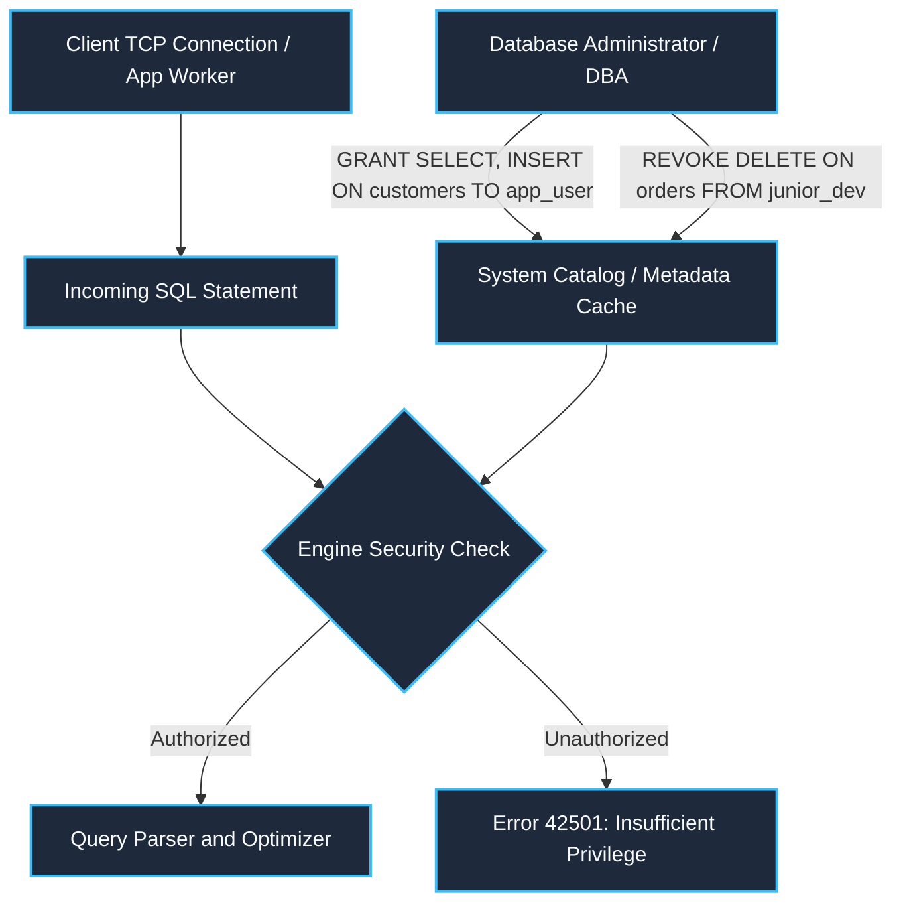
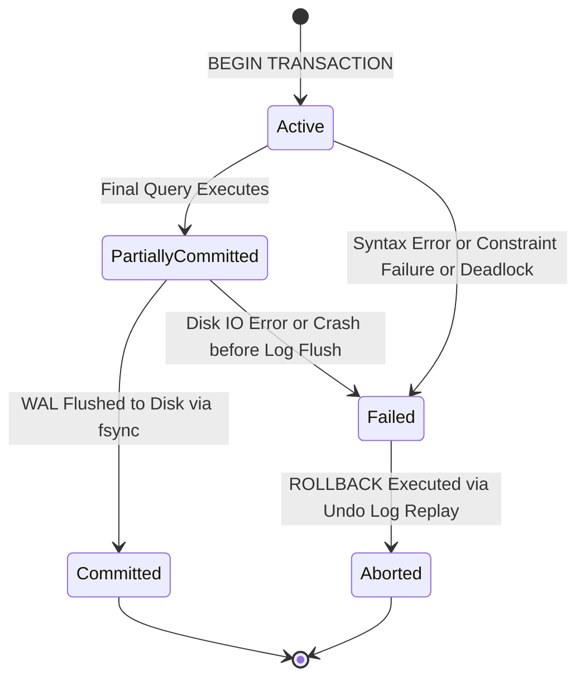
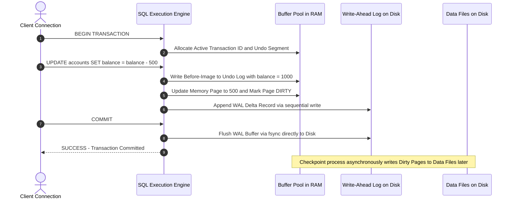
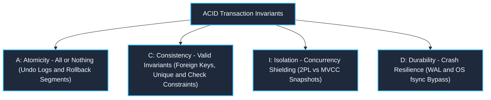
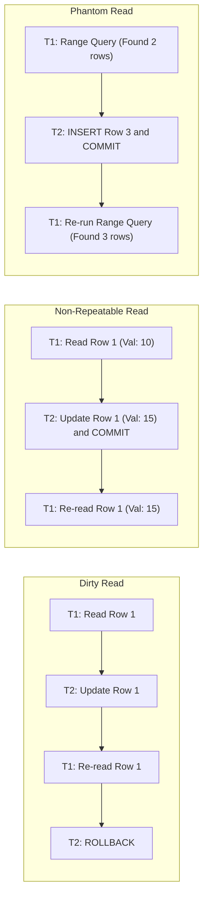
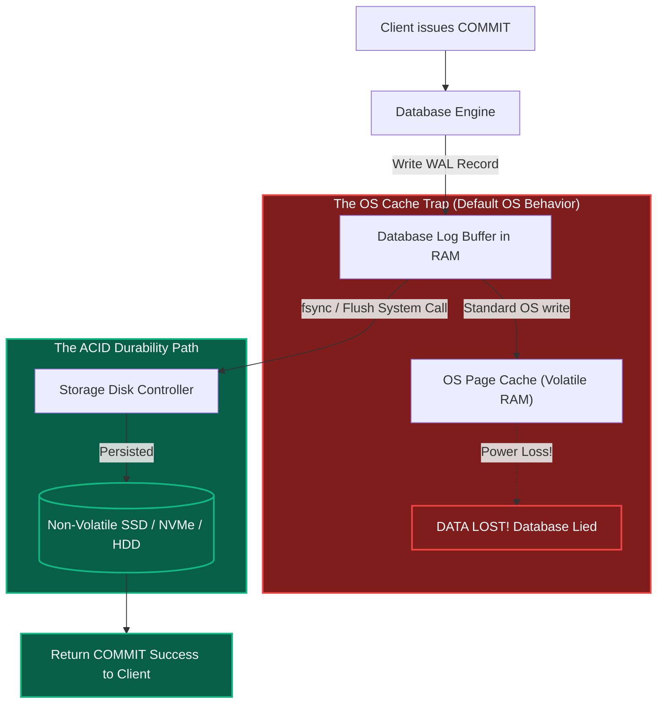

# 003: DCL, TCL & ACID Transaction Engine Architecture

A unified, deep-dive database engineering manual synthesizing:
- **`withBara`**: Practical query structure, operational SQL command families (DDL/DML/DQL/TCL/DCL), and banking transfer models.
- **`withNasser`**: Storage engine internals, RAM buffer pools, OS cache traps, `fsync()` bypass, Undo stacks, MVCC, and read phenomena.
- **Architectural Engineering Insights**: Transaction state machines, Read-Only optimization paths, Transaction ID (XID) wraparound, long-running transaction bloat, distributed 2PC (Two-Phase Commit), and deadlock graph detection.

---

## 1. Context & Multi-Source Synthesis Matrix

| Dimension | `withBara` Contribution | `withNasser` Contribution | Advanced Engineering Reasoning & Insights |
| :--- | :--- | :--- | :--- |
| **SQL Operational Lifecycle** | Database evolution: Structure (`DDL`) → Data Rows (`DML`) → Analytical Querying (`DQL`). | How multiple TCP client connections create concurrent physical contention on shared disk pages. | **Transaction Boundaries**: Implicit transactions (autocommit) vs Explicit transactions (`BEGIN ... COMMIT`). |
| **DCL / Governance** | Syntax and permission commands: `GRANT`, `REVOKE`, `DENY`. | Authorization tokens validated against system catalog pages before compilation. | Principle of Least Privilege in microservices; security catalog caching and invalidation hooks. |
| **TCL / Transactions** | Logical units of work: `BEGIN`, `COMMIT`, `ROLLBACK`, `SAVEPOINT`. | Active Transaction IDs (XID), Undo Log stacks, Rollback segments, and RAM page dirty bits. | **Transaction State Machine**: `ACTIVE` → `PARTIALLY COMMITTED` → `COMMITTED` vs `FAILED` → `ABORTED`. Read-only vs Read-write XID allocation savings. |
| **Durability Mechanics** | High-level disk persistence upon commit. | **OS Buffer Cache bypass**, the role of `fsync()`, and why sequential Write-Ahead Logging (WAL) beats random B-tree page writes. | The cost of Group Commit, disk write amplification, NVMe write caches, and write exhaustion. |
| **Isolation Mechanics** | Basic multi-user concurrency and locking. | **4 Read Phenomena** (Dirty, Non-Repeatable, Phantom, Lost Updates), **2PL** vs **MVCC**, MySQL Undo stacks vs Postgres tuple versioning. | Serialization Graph Checking (SGT), Snapshot Isolation anomalies (Write Skew), and Deadlock Cycle Detection (`Wait-For Graph`). |

---

## 2. DCL: Data Control Language (Security & Privilege Governance)

> **Source Attribution**: Derived from **`@withBara`** (`Section 01: Introduction to SQL` → `08_Types of SQL Commands.md`, `SQL_Cheat_Sheet.sql`) and **`@withNasser`** (`Section 01: Database Fundamentals` → Client Connections & Catalog Validation).

### What is DCL?
DCL commands manage user privileges, role-based access control (RBAC), and security permissions across tables, schemas, views, and stored procedures.



### Core Commands (From `@withBara`)
- **`GRANT`**: Allocates specific permissions (`SELECT`, `INSERT`, `UPDATE`, `DELETE`, `EXECUTE`) to a user, group, or role.
  ```sql
  GRANT SELECT, INSERT ON customers TO SalesAppRole;
  GRANT EXECUTE ON PROCEDURE ProcessMonthlyInvoice TO FinanceTeam;
  ```
- **`REVOKE`**: Removes previously allocated permissions.
  ```sql
  REVOKE DROP, TRUNCATE ON customers FROM SalesAppRole;
  ```
- **`DENY`** *(SQL Server / Enterprise Dialects)*: Explicitly blocks a user or role from an action, overriding any inherited permissions.

### 💡 Agent Reasoning & Architectural Simplification: System Catalog Lookups & Caching
- **Why this matters in plain terms**: Imagine a high-security office building. Before you are allowed to press the elevator button (run a query on disk), the front desk guard checks your badge in a fast memory list.
- **Internal Engine Mechanics**: When a client sends a SQL query, the database engine executes an **Authorization Phase** *before* query compilation. It validates the session's security credentials against the cached system catalog in RAM (e.g., `sys.database_permissions` in SQL Server, `pg_authid` in PostgreSQL, `mysql.user` in MySQL). If authorization fails, the query is rejected immediately with zero disk read overhead.

---

## 3. Deep-Dive: Transactions & TCL (Controlling Units of Work)

> **Source Attribution**: Synthesized from **`@withBara`** (`Section 04: Data Manipulation (DML)` & `SQL_Cheat_Sheet.sql`) and **`@withNasser`** (`Section 02: ACID` → `06_What is a Database Transaction.md`, `08_Atomicity.md`, `14_Read Only Transactions.md`).

### 3.1 What is a Transaction?
A transaction is not merely a collection of queries; it is a **formal contract of state transition**. It bundles one or more operations (usually DML: `INSERT`, `UPDATE`, `DELETE`) such that the database moves from one globally consistent state to another, guaranteeing that all intermediate, uncommitted states remain invisible and discardable.

### 3.2 The Formal Transaction State Machine (Agent Architectural Synthesis)

To make transaction execution intuitive, we can model how any database engine tracks a transaction's life through five distinct states:



1. **Active**: The initial state when `BEGIN` is called. The transaction executes read and write operations. Dirty buffers accumulate in RAM.
2. **Partially Committed**: The final statement has executed, but log buffers have not yet been guaranteed on non-volatile physical storage.
3. **Committed**: The `COMMIT` record is safely written and flushed to physical disk (`fsync`). The state transition is now irrevocable.
4. **Failed**: An integrity constraint check (`CHECK`, `FOREIGN KEY`), syntax error, or deadlock detector aborts execution.
5. **Aborted**: The engine walks the **Undo Log**, restoring previous column values, releasing acquired row locks, and returning the database to its pre-transaction state.

---

### 3.3 The Banking Metaphor (Why TCL is Mandatory)
Consider transferring 500 dollars between two bank accounts:
```sql
BEGIN TRANSACTION;
-- Step 1: Check balance
SELECT balance FROM accounts WHERE account_id = 'A';

-- Step 2: Deduct from Account A
UPDATE accounts SET balance = balance - 500 WHERE account_id = 'A';

-- CRITICAL WINDOW: Power failure, network loss, or process killed here --

-- Step 3: Add to Account B
UPDATE accounts SET balance = balance + 500 WHERE account_id = 'B';
COMMIT;
```
If the system crashes after Step 2, the 500 dollars vanishes without TCL. With TCL, the engine guarantees that both updates either **commit together** or **roll back completely**.

---

### 3.4 Physical Anatomy of a Transaction in Memory and Disk



1. **`BEGIN TRANSACTION`** (or `START TRANSACTION`):
   - Opens a transactional boundary.
   - The engine assigns an **Active Transaction ID (XID)**.
2. **`COMMIT`**:
   - Persists all operations permanently.
   - **Engine Action**: The engine appends a commit record to the **Write-Ahead Log (WAL / Redo Log)** and issues an `fsync()` system call to flush the log buffer to physical non-volatile storage. Once this log write completes, the client receives confirmation.
3. **`ROLLBACK`**:
   - Reverts all uncommitted changes back to the state before `BEGIN`.
   - **Engine Action**: The engine walks backward through the **Undo Log**, restoring previous column values into the memory buffer, and releases acquired row locks.
4. **`SAVEPOINT <name>`**:
   - Sets an intermediate checkpoint inside a large transaction, allowing partial rollbacks without aborting the entire sequence.
   ```sql
   BEGIN TRANSACTION;
   INSERT INTO orders (order_id, customer_id) VALUES (101, 1);
   SAVEPOINT Step1Completed;

   -- Risky operation
   UPDATE inventory SET stock = stock - 1 WHERE product_id = 999;
   
   -- If an error occurs, rollback only to Step1:
   ROLLBACK TRANSACTION Step1Completed;
   COMMIT;
   ```

---

### 3.5 Architectural Insights: Transaction Engine Nuances

#### Insight 1: Read-Only vs. Read-Write Transactions (The XID Cost)
- As Hussein Nasser highlights, allocating a **Transaction ID (XID)** is expensive. Every XID consumes transaction slot entries, bloats the system transaction table, and forces vacuum/cleanup processes to evaluate row visibility against it.
- **Engine Optimization**: Modern engines (PostgreSQL, MySQL) do **not** assign an XID to read-only queries upon `BEGIN`. A transaction remains a "virtual transaction" with zero logging overhead until its very first DML write statement (`INSERT`, `UPDATE`, `DELETE`) is issued!
- **Engineering Tip**: Explicitly declaring `BEGIN TRANSACTION READ ONLY;` in Postgres or MySQL allows the engine to skip lock allocations and optimize query plan execution without risk of XID exhaustion.

#### Insight 2: Transaction ID Wraparound (The 32-Bit Ceiling)
- In PostgreSQL, transaction IDs are 32-bit integers, representing roughly 4.2 billion transactions.
- Because transactions cycle in a circular sequence, the engine uses modulo arithmetic: half the IDs are in the "past", and half are in the "future".
- If a database runs 2 billion transactions without maintenance, it faces **Transaction ID Wraparound**, where old committed rows suddenly appear to belong to the future and become invisible! PostgreSQL prevents this via background **VACUUM FREEZE**, which converts ancient XIDs into a special static identifier (`FrozenTransactionId`).

#### Insight 3: The Danger of Long-Running Transactions (Idle in Transaction)
- If a backend worker opens a transaction (`BEGIN`), performs a query, and then waits for external network APIs (e.g. Stripe payment, third-party webhook) before calling `COMMIT`:
  1. **Lock Starvation**: Rows and table pages remain locked, blocking concurrent workers.
  2. **Undo Log / WAL Bloat**: The engine **cannot purge undo records or vacuum old dead tuples** because the long-running transaction might still need to see older snapshots. Disk usage balloons rapidly.
  3. **Rule**: *Never make network I/O calls inside a database transaction boundary.*

#### Insight 4: Deadlocks & The Wait-For Graph
- When Transaction 1 holds a lock on Row A and requests Row B, while Transaction 2 holds a lock on Row B and requests Row A, a **Deadlock** occurs.
- The engine runs a background **Deadlock Detector** that builds a directed **Wait-For Graph**:
  ```
  T1 ---> Waiting for Row B ---> Held by T2
  T2 ---> Waiting for Row A ---> Held by T1  (CYCLE DETECTED!)
  ```
- The engine breaks the cycle by selecting one transaction as the **victim**, issuing an internal `ROLLBACK`, and throwing an exception (e.g. Postgres `ERROR: 40P01: deadlock detected`) so the other can proceed.

---

## 4. The ACID Properties: Deep Engine Internals & Concurrency Invariants

> **Source Attribution**: Derived from **`@withNasser`** (`Section 02: ACID` → `08_Atomicity.md`, `09_Isolation.md`, `10_Consistency.md`, `11_Durability.md`, `13_Phantom Reads.md`, `15_Serializable vs Repeatable Read.md`) blended with **Agent Reasoning & Simplification** for storage engine clarity.

Relational databases guarantee reliability through four invariant properties: **Atomicity**, **Consistency**, **Isolation**, and **Durability**.



---

### 1. Atomicity ("All or Nothing")

- **The Problem**: A transaction executes 5 updates; after update 3, an unhandled exception or power crash kills the process.
- **Engine Mechanics (Hussein Nasser Deep Dive)**:
  - Database systems implement **Undo Logs** (Rollback Segments in Oracle, Undo Pages in MySQL InnoDB, WAL deltas in PostgreSQL).
  - Before modifying a page in memory, the engine writes the *previous value* to the undo structure.
  - If a transaction aborts or fails, the engine executes an **Undo Pass**, reading the undo chain in reverse order to overwrite dirty RAM buffers with original values.

---

### 2. Consistency ("Preserving Invariants")

- **The Problem**: Business rules violated during execution (e.g. negative balances, dangling foreign keys, orphan records).
- **Engine Mechanics**:
  - Consistency in ACID represents *state invariants*. The database must transition only from one valid state to another valid state.
  - Enforced through:
    1. **Primary & Unique Key Constraints**: Prevents duplicate records using index checks.
    2. **Foreign Key Integrity**: Enforces parent-child relationships (`ON DELETE CASCADE / RESTRICT`).
    3. **Check Constraints**: Enforces domain bounds (`CHECK (balance >= 0)`).
  - If any constraint evaluates to `FALSE` during transaction execution, the engine automatically aborts the statement and triggers an internal rollback.

---

### 3. Isolation ("Shielding Concurrent Workers")

As Hussein Nasser emphasizes, isolation is **the most complex, underrated property in database engineering**. When hundreds of TCP connections execute transactions concurrently, four nasty **Read Phenomena** arise:

#### The 4 Read Phenomena:
1. **Dirty Read**: Transaction A reads data modified by Transaction B that has *not yet committed*. If Transaction B rolls back, Transaction A operated on invalid data.
2. **Non-Repeatable Read**: Transaction A reads a row value. Transaction B updates that row and commits. Transaction A re-reads the row and gets different data.
3. **Phantom Read**: Transaction A executes a range query (`WHERE score > 80`). Transaction B inserts a new row matching that range and commits. Transaction A re-runs the query and discovers a new "phantom" row that did not exist before.
4. **Lost Update**: Transaction A and Transaction B read the same row concurrently, calculate updates, and write back. The faster transaction's update is completely overwritten by the slower one.



#### The Four SQL Isolation Levels:
| Isolation Level | Dirty Read | Non-Repeatable Read | Phantom Read | Engine Mechanism |
| :--- | :---: | :---: | :---: | :--- |
| **Read Uncommitted** | ALLOWED | ALLOWED | ALLOWED | Direct reads from dirty memory buffers; zero locking. |
| **Read Committed** *(Postgres Default)* | PREVENTED | ALLOWED | ALLOWED | Every individual query takes a new MVCC snapshot. |
| **Repeatable Read** *(MySQL Default)* | PREVENTED | PREVENTED | ALLOWED / PREVENTED* | Snapshot established once at transaction start; row locks or version pointers held. |
| **Serializable** | PREVENTED | PREVENTED | PREVENTED | Strict 2PL range locks, predicate locks, or Serializable Snapshot Isolation (SSI). |

*Note: In MySQL InnoDB, Repeatable Read also prevents Phantom Reads in practice using **Next-Key Locks** (combining index record locks with gap locks).*

#### Engine Concurrency Architectures:
- **Pessimistic Concurrency (Two-Phase Locking - 2PL)**:
  - Uses Shared Locks (`S-Lock`) for reading and Exclusive Locks (`X-Lock`) for writing.
  - Readers block writers; writers block readers. High safety, but causes lock escalation, contention, and deadlocks.
- **Optimistic Concurrency / MVCC (Multi-Version Concurrency Control)**:
  - **PostgreSQL**: When a row is updated, PostgreSQL does not overwrite the row in place. It appends a **new version (tuple)** to the data page tagged with `xmin` (creating transaction) and `xmax` (deleting transaction). Readers never block writers!
  - **MySQL / InnoDB**: Modifies the row in place on the data page, but builds an **Undo Log chain** in memory/disk. When a reader requires an older snapshot, it traverses the undo log backward to reconstruct the earlier state.

---

### 4. Durability ("Surviving Crashes & The OS Cache Problem")

Durability guarantees that once a transaction commits, its modifications will **never be lost**, even if the machine loses power a millisecond later.

#### The OS Cache Trap & The `fsync()` Solution
As detailed in Hussein Nasser's lecture:
> *"When a database issues a write command, the operating system (Windows/Linux) does something shady: it doesn't write to disk immediately. It writes to the **OS Page Cache** in RAM to batch writes for performance. If the server loses power while the log is still in the OS cache, the database lied to you about committing!"*



#### Why Write-Ahead Logging (WAL) Instead of Writing Tables Directly?
- Writing modified table pages directly to disk is **extremely slow** because data pages are scattered across disk (Random I/O), and tables have indexes, secondary B-trees, and constraints.
- Instead, the engine writes only a compact delta record to the **WAL** (Sequential I/O), which is orders of magnitude faster.
- The engine issues `fsync()` to force the OS to bypass its cache and write the WAL record to disk. Only after the WAL write succeeds does the engine return `COMMIT OK`.

#### The ARIES Crash Recovery Algorithm:
On reboot after an abrupt crash, the database engine recovers in 3 phases:
1. **Analysis Phase**: Scans the WAL forward from the last checkpoint to identify active transactions and dirty buffer pages at the time of the crash.
2. **Redo Phase**: Replays all committed changes from the log that were not yet written to data files on disk ("repeating history").
3. **Undo Phase**: Reverses all uncommitted transactions that were still in flight when the power died, restoring the database to a completely consistent state.

---

## 5. Master Architecture Comparison Table

| Dimension | DCL (Data Control) | TCL (Transaction Control) | ACID Invariants |
| :--- | :--- | :--- | :--- |
| **Primary Scope** | Security, Permissions, Role Governance | Transaction Scope & Boundary Management | Mathematical Guarantees of the Storage Engine |
| **Key SQL Commands** | `GRANT`, `REVOKE`, `DENY` | `BEGIN`, `COMMIT`, `ROLLBACK`, `SAVEPOINT` | Implicitly enforced on all DML operations |
| **Memory Structures** | Authorization Token Cache, System Catalog | Active Transaction Table (XID), Undo Buffer | Buffer Pool, Undo Stack, MVCC tuple versions |
| **Disk Structures** | Catalog Tables (`sys.database_permissions`) | WAL / Redo Log segments, Rollback segments | Non-volatile Data Pages, Append-only WAL files |
| **Failure Protection** | Blocks unauthorized queries at parse phase | Prevents partial, half-applied updates | Guaranteed recovery via ARIES and `fsync()` flush |
