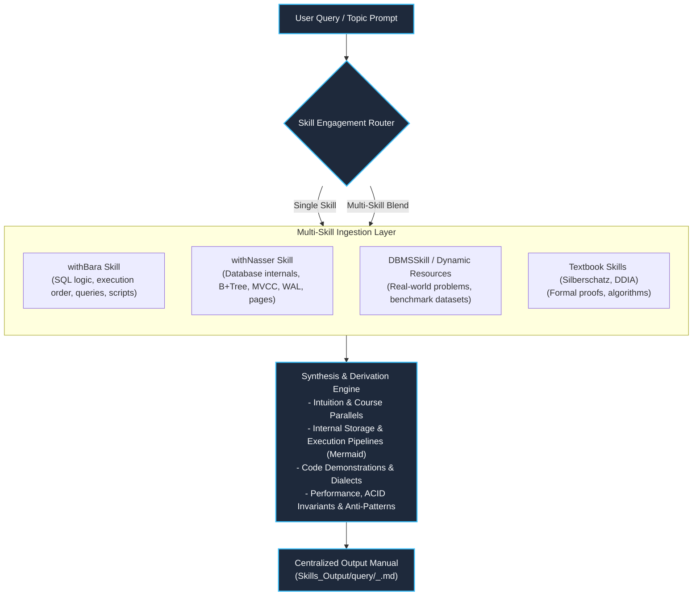

# Universal Query Output Archive (`Skills_Output/query/`)

This directory serves as the **centralized knowledge output hub** for all investigative queries, deep-dive manuals, engine internal analyses, and cross-course syntheses.

Whether a query is derived from a single course (e.g. `withBara`), a single book, or combines multiple sources (e.g. `withBara` for SQL syntax & execution order + `withNasser` for disk page & MVCC storage mechanics + `DBMSSkill` dynamic problems), the final output manual is cataloged here under a single, unified index.

---

## ⚡ Query Execution & Multi-Skill Synthesis Matrix



---

## 📑 Master Query Manuals Index

| Query ID | Title / Manual Topic | Skills & Resources Utilized | Focus & Core Invariants | Status |
| :---: | :--- | :--- | :--- | :---: |
| [`001`](001_sql_logical_execution_order_internals.md) | **SQL Logical Execution Order & Internal Engine Processing** | `withBara` (`02_SELECT Query`, `01_Query_Data_SELECT.sql`) | 7-stage engine execution pipeline, 5 types of SQL filters, coding vs execution timing | ✅ Published |
| [`002`](002_types_of_sql_commands.md) | **Types of SQL Commands & Engine Operational Families** | `withBara` (`01_Introduction to SQL`, `01_SQL_Introduction.pdf`) | Lifecycle of an empty database: DDL (structure), DML (rows), DQL (retrieval), TCL, DCL | ✅ Published |
| [`003`](003_dcl_tcl_acid_properties_internals.md) | **DCL, TCL & ACID Transaction Engine Architecture** | `withBara` & `withNasser` (Dual Course Blend) | Permissions catalog, banking transfer, Undo stacks, OS cache bypass, fsync, MVCC vs 2PL, read phenomena, and ARIES recovery | ✅ Published |
| [`004`](004_acid_transactions_concurrency_deep_dive.md) | **ACID Transactions & Concurrency Anomalies Deep Dive** | `withNasser` (`02_ACID`, slides, MySQL/Postgres scripts) | Undo logs vs Redo logs, Dirty/Non-repeatable/Phantom reads, Repeatable Read vs Serializable | ✅ Published |

---

## 📐 Unified Manual Output Standard

Every query manual generated in `Skills_Output/query/` follows this standardized schema:

```markdown
# [NNN]: <Topic Title>

A comprehensive manual synthesized using <List of Skills / Sources Used>.

---

## 1. Context & Source Attribution
- **Skills Engaged**: `@withBara`, `@withNasser`, `@DBMSSkill`, etc.
- **Lectures / Chapters Referenced**: Section numbers and lecture titles.
- **Companion Resources**: Slide decks (`.pdf`), runnable scripts (`.sql`), benchmark files.

## 2. Intuition & Pedagogical Walkthrough
- Plain-English breakdown explaining the dilemma, motivation, and conceptual foundation.

## 3. Physical & Internal Engine Mechanics
- Step-by-step pipeline illustrating what the storage engine, buffer pool, and lock manager do.
- Visual Mermaid diagrams (flowcharts, sequence diagrams, state models).

## 4. Multi-Dialect & Practical Code Implementations
- Runnable SQL scripts (PostgreSQL, MySQL, SQL Server) reflecting the topic.
- Contrasts between correct idioms and anti-patterns.

## 5. Failure Modes, Concurrency & Performance Audits
- Buffer hits vs disk reads, locking bottlenecks, memory leaks, and index selectivity checks.
```

