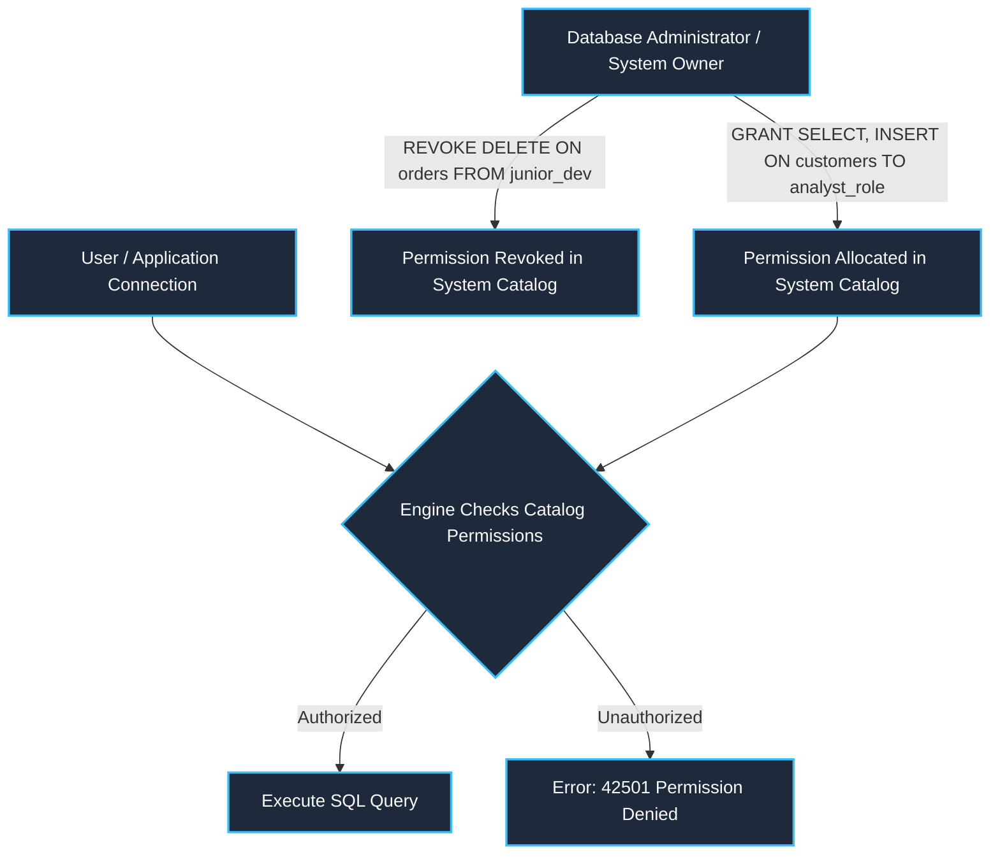
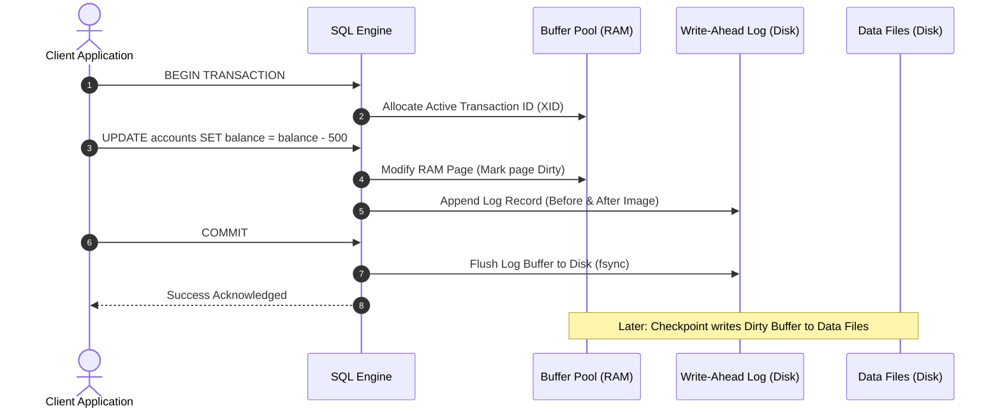
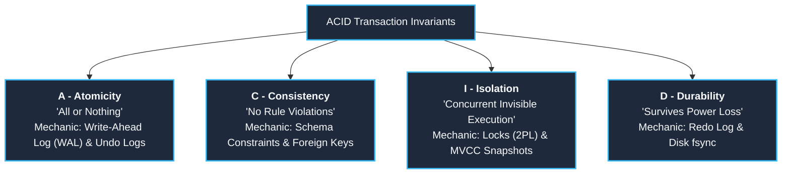

# 003: DCL, TCL & ACID Transaction Engine Architecture

A comprehensive, internal engine manual examining **DCL (Data Control Language)**, **TCL (Transaction Control Language)**, and **ACID Properties**, structured according to the *withBara* course pedagogy, cross-referencing `Skills_Input/udemy/withBara/01_Introduction to SQL/08_Types of SQL Commands.md`, `Resources/02_docs/10_Performance_Optimization.pdf`, and database engine transaction processing fundamentals.

---

## 1. Context & Architectural Overview

In **withBara (Section 01, Lecture 08)**, SQL command families were introduced through the lifecycle of a database:
1. **DDL** (`CREATE`, `ALTER`, `DROP`) builds the schema structures.
2. **DML** (`INSERT`, `UPDATE`, `DELETE`) populates and alters data rows.
3. **DQL** (`SELECT`) queries and analyzes the data.

However, in multi-user production databases and OLTP systems (as discussed in `10_Performance_Optimization.pdf`), raw DML operations cannot execute in isolation. If a power outage occurs midway through a fund transfer, or two users update the same customer record simultaneously, the database risks corruption.

To guarantee security, atomicity, and multi-user concurrency control, SQL introduces two essential operational families:
- **DCL (Data Control Language)**: Security, role access, and privilege governance.
- **TCL (Transaction Control Language)**: Managing atomic units of work, boundaries, and savepoints.
- **ACID Guarantees**: The four foundational invariants that the database engine enforces during transaction execution.

---

## 2. DCL: Data Control Language (Security & Privilege Governance)

### What is DCL?
DCL commands manage user privileges and security permissions across tables, views, schemas, and stored procedures.



### Core DCL Commands
1. **`GRANT`**: Gives specific permissions (e.g., `SELECT`, `INSERT`, `UPDATE`, `DELETE`, `EXECUTE`) to a user, group, or role.
   ```sql
   -- Give read-only access to sales reporting users
   GRANT SELECT ON customers TO SalesReportingRole;
   GRANT SELECT, INSERT ON orders TO WebApplicationUser;
   ```
2. **`REVOKE`**: Removes previously granted permissions.
   ```sql
   -- Remove destructive permissions from web application user
   REVOKE DROP, TRUNCATE ON customers FROM WebApplicationUser;
   ```
3. **`DENY`** *(SQL Server specific)*: Explicitly prevents a user or role from executing a command, overriding any inherited group permissions.

### Engine Internals: How DCL Operates Under the Hood
- DCL statements modify the **Database System Catalog** / **Data Dictionary** (e.g., `sys.database_permissions` in SQL Server, `pg_authid` / `information_schema` in PostgreSQL).
- When a client connects and sends a query, the SQL engine's **Authorization Phase** evaluates the session's security token against the cached permission map *before* parsing or executing the query plan.

---

## 3. TCL: Transaction Control Language (Controlling Units of Work)

### What is a Transaction?
A transaction is a logical unit of work comprising one or more SQL statements (usually DML: `INSERT`, `UPDATE`, `DELETE`) that must execute together as a single, indivisible entity.

### The Banking Metaphor (Why TCL is Mandatory)
Imagine transferring \$500 from Account A to Account B:
```sql
-- Step 1: Deduct from Account A
UPDATE accounts SET balance = balance - 500 WHERE account_id = 'A';

-- SYSTEM CRASH / POWER FAILURE / NETWORK LOSS HERE --

-- Step 2: Add to Account B
UPDATE accounts SET balance = balance + 500 WHERE account_id = 'B';
```
If the database crashes after Step 1, \$500 has vanished into thin air. TCL exists so the engine treats both updates as **all-or-nothing**.

---

### Core TCL Commands



1. **`BEGIN TRANSACTION`** (or `BEGIN / START TRANSACTION`):
   - Explicitly starts a new transactional scope.
   - The engine assigns a unique **Transaction ID (XID)** and creates an entry in the transaction state table.
2. **`COMMIT`**:
   - Permanently saves all changes made during the transaction to the database.
   - **Engine Action**: The engine writes a `COMMIT` record to the **Write-Ahead Log (WAL / Transaction Log)** and flushes it to disk (`fsync`). Once this log flush completes, the transaction is officially durable.
3. **`ROLLBACK`**:
   - Reverts all modifications made during the transaction back to the initial state as if nothing happened.
   - **Engine Action**: The engine reads the undo records in the transaction log and reapplies the "before images" to memory pages, then releases all locks.
4. **`SAVEPOINT <name>`**:
   - Establishes a temporary checkpoint within a large transaction, allowing partial rollbacks without aborting the entire sequence.
   ```sql
   BEGIN TRANSACTION;
   INSERT INTO orders (order_id, customer_id) VALUES (101, 1);
   SAVEPOINT Step1Completed;

   -- Risky operation
   UPDATE inventory SET stock = stock - 1 WHERE product_id = 999;
   -- If product_id 999 is invalid, rollback only to Step1:
   ROLLBACK TRANSACTION Step1Completed;

   COMMIT;
   ```

---

## 4. The ACID Properties: How the Storage Engine Guarantees Invariants

Relational databases guarantee reliability through four invariant properties: **A**tomicity, **C**onsistency, **I**solation, and **D**urability.



### 1. Atomicity ("All or Nothing")
- **Definition**: Every statement in the transaction must execute successfully to completion. If any statement fails or the system crashes, all changes made so far are completely undone.
- **Engine Mechanic**:
  - The engine uses **Undo Logs** (Rollback Segments in Oracle/MySQL, Undo Records in SQL Server, WAL in PostgreSQL).
  - Every modified row stores its *old value* (before image). If a failure occurs, the recovery manager walks backward through the undo records and reverses each change.

### 2. Consistency ("Preserving Invariants")
- **Definition**: The database transitions only from one valid state to another valid state. All integrity constraints, data types, foreign keys, unique indexes, and domain rules must remain valid.
- **Engine Mechanic**:
  - If a transaction attempts an operation that violates a `CHECK (score >= 0)` constraint, a `FOREIGN KEY`, or a `NOT NULL` constraint, the engine automatically triggers an internal `ROLLBACK` for that statement or transaction.

### 3. Isolation ("Independent Concurrent Execution")
- **Definition**: Even when thousands of transactions execute simultaneously (e.g. OLTP systems described in `10_Performance_Optimization.pdf`), each transaction executes as if it were the only one running on the system. Intermediate uncommitted changes are shielded from concurrent sessions.
- **Engine Mechanic**:
  - **Pessimistic Concurrency**: Uses shared (read) and exclusive (write) locks via **Two-Phase Locking (2PL)**.
  - **Optimistic Concurrency / MVCC (Multi-Version Concurrency Control)**: Stores multiple version timestamps of rows in `tempdb` or table space, allowing readers to read older consistent snapshots without blocking writers.

#### Transaction Isolation Levels & Concurrency Phenomena:
| Isolation Level | Dirty Read | Non-Repeatable Read | Phantom Read | Engine Mechanism |
| :--- | :---: | :---: | :---: | :--- |
| **Read Uncommitted** | ❌ Allowed | ❌ Allowed | ❌ Allowed | No read locks acquired; reads dirty RAM buffers. |
| **Read Committed** *(Default)* |  Prevented | ❌ Allowed | ❌ Allowed | Acquires short-term read locks or reads committed snapshot. |
| **Repeatable Read** |  Prevented |  Prevented | ❌ Allowed | Holds read locks until transaction completes. |
| **Serializable** |  Prevented |  Prevented |  Prevented | Range locking / strict predicate locking; strict serial execution. |

### 4. Durability ("Survives Any Crash")
- **Definition**: Once a transaction is acknowledged as committed, its changes are guaranteed to survive any subsequent system crash, power failure, or OS crash.
- **Engine Mechanic**:
  - Relies on **ARIES Recovery Protocol** and the **Write-Ahead Logging (WAL)** rule:
    > *"A memory page (dirty buffer) must never be written to data disk files until the corresponding transaction log record has been safely flushed to persistent disk storage."*
  - On engine reboot after a sudden crash, the engine executes:
    1. **Analysis Pass**: Identifies all active transactions and dirty pages at the time of the crash.
    2. **Redo Pass**: Replays all committed changes from the log that were not yet flushed to data files.
    3. **Undo Pass**: Rolls back all transactions that were active/uncommitted when the power died.

---

## 5. Master Summary Table

| Category / Invariant | Core Keywords / Mechanics | Key Objective | Storage Engine Implementation |
| :--- | :--- | :--- | :--- |
| **DCL** | `GRANT`, `REVOKE`, `DENY` | Access Security & RBAC | Reads & writes internal authorization catalogs |
| **TCL** | `BEGIN`, `COMMIT`, `ROLLBACK`, `SAVEPOINT` | Defines Transaction Boundaries | Manages Active Transaction Table & Undo Log |
| **Atomicity (A)** | `ROLLBACK`, Undo Log | All-or-nothing execution | Undoes dirty modifications using before-images |
| **Consistency (C)**| Constraints, Primary Keys, Foreign Keys | Valid database states | Validates relational schema rules prior to commit |
| **Isolation (I)** | Locks, Isolation Levels, MVCC | Concurrency without interference | 2-Phase Locking (2PL) or row version snapshots |
| **Durability (D)** | WAL / Transaction Log, `COMMIT` | Crash resilience | Flushes Redo logs via disk `fsync` before ACK |
