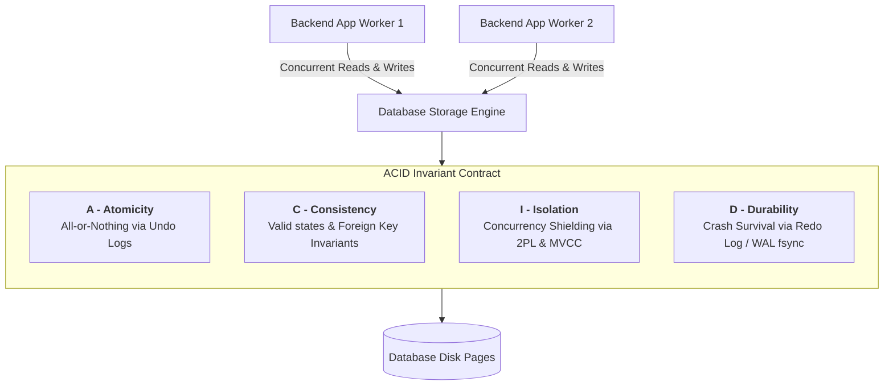

# 001: ACID Transactions & Concurrency Anomalies Deep Dive

A comprehensive database internals manual based on **Section 02: ACID** from Hussein Nasser's *Fundamentals of Database Engineering*, cross-referencing `Skills_Input/udemy/withNasser/02_ACID/`, companion slides, and MySQL/Postgres isolation benchmarks.

---

## 1. Course Context & Educational Focus
- **Course Module**: `02_ACID`
- **Instructor**: Hussein Nasser
- **Key Lectures**:
  - `01_Introduction to ACID.md`
  - `02_Atomicity.md`
  - `03_Consistency.md`
  - `04_Isolation.md`
  - `05_Durability.md`
  - `06_Read Phenomena.md`
  - `07_Dirty Reads.md`
  - `08_Phantom Reads.md`
  - `09_Serializable vs Repeatable Read.md`
- **Companion Resources**:
  - Slide Decks: `Skills_Input/udemy/withNasser/18_Archived Lectures/01_ACID.pdf`
  - Commands Script: `Skills_Input/udemy/withNasser/02_ACID/08_mysql-commands.txt`

---

## 2. Intuition: Why ACID is Essential to Database Engineering

As taught by Hussein Nasser:
> *"A database without transactions is just a collection of files. When multiple backend connections write to the same disk pages concurrently, chaos ensues. ACID is not a single tool—it is a contract between the database storage engine and the software engineer guaranteeing that concurrent execution remains mathematically correct and resilient to crashes."*

---

## 3. Dissecting the Four Pillars

### 1. Atomicity (All or Nothing)
- **The Core Problem**: A transaction contains 5 writes. After write 3, the OS crashes or the power dies. The table now contains corrupted, half-applied state.
- **Engine Mechanics**:
  - The engine uses **Undo Logs** (Undo Pages in MySQL InnoDB, Rollback Segments, WAL in Postgres).
  - Before modifying a page in memory, the engine writes the *previous value* to the undo log.
  - If a rollback occurs (or crash recovery runs), the engine replays the undo records in reverse order to restore the original page state.

### 2. Consistency (State Transitions & Invariants)
- **The Core Problem**: Inconsistent states (e.g. Account balance becomes negative, or an order references a non-existent customer).
- **Engine Mechanics**:
  - Consistency in ACID refers to *application-level and schema-level invariants*.
  - Handled by primary key constraints, foreign key referential integrity checks, unique constraints, and check constraints (`CHECK balance >= 0`).
  - If an invariant is violated at any point during the transaction, the entire transaction is aborted and rolled back.

### 3. Isolation (Shielding Concurrent Workers)
- **The Core Problem**: Concurrent transactions reading and updating the same rows.
- **Engine Mechanics**:
  - **Pessimistic Concurrency**: Locks (Shared S-locks for readers, Exclusive X-locks for writers) using Two-Phase Locking (2PL).
  - **Optimistic Concurrency / MVCC (Multi-Version Concurrency Control)**: Rather than locking, every row has transaction creation/deletion IDs (`xmin`/`xmax` in Postgres, `DB_TRX_ID` in InnoDB). Readers read the snapshot matching their transaction start time without blocking writers!

#### The Four Isolation Levels & Read Phenomena:
1. **Dirty Read**: Transaction A reads data modified by Transaction B that has *not yet committed*. If Transaction B rolls back, Transaction A acted on garbage data.
2. **Non-Repeatable Read**: Transaction A reads row X. Transaction B modifies row X and commits. Transaction A re-reads row X and sees different values.
3. **Phantom Read**: Transaction A reads a range of rows (`WHERE score > 80`). Transaction B inserts a new row matching that range and commits. Transaction A re-reads and discovers a new "phantom" row.

| Isolation Level | Dirty Read | Non-Repeatable Read | Phantom Read | Typical Engine Mechanism |
| :--- | :---: | :---: | :---: | :--- |
| **Read Uncommitted** | ❌ Allowed | ❌ Allowed | ❌ Allowed | Direct dirty buffer read |
| **Read Committed** *(Postgres Default)* |  Prevented | ❌ Allowed | ❌ Allowed | New MVCC snapshot per query |
| **Repeatable Read** *(MySQL InnoDB Default)* |  Prevented |  Prevented | ❌ /  Prevented* | One MVCC snapshot per transaction |
| **Serializable** |  Prevented |  Prevented |  Prevented | Strict 2PL or SSI (Serializable Snapshot Isolation) |

*\*Note: MySQL InnoDB uses Next-Key Locks (Index-record lock + Gap lock) to prevent phantom reads even in Repeatable Read!*

### 4. Durability (Surviving Crashes)
- **The Core Problem**: RAM is volatile. If the server loses power, dirty pages in the buffer pool are wiped.
- **Engine Mechanics**:
  - The engine uses a **Write-Ahead Log (WAL) / Redo Log**.
  - Writing random data pages to disk is slow (random I/O). Writing append-only log records is extremely fast (sequential I/O).
  - When you `COMMIT`, the engine flushes only the WAL log buffer to disk with an `fsync()` call.
  - Even if the data files on disk are out of date, the engine replays the redo log during reboot to reconstruct all committed changes.

---

## 4. Key Takeaway & Architecture Rules

1. **Isolation has a Cost**: Higher isolation levels (Serializable) eliminate anomalies but reduce concurrency and throughput due to lock contention or serialization aborts (`40001: could not serialize access`).
2. **Postgres vs MySQL Defaults**: Always remember that PostgreSQL defaults to **Read Committed**, while MySQL InnoDB defaults to **Repeatable Read**.
